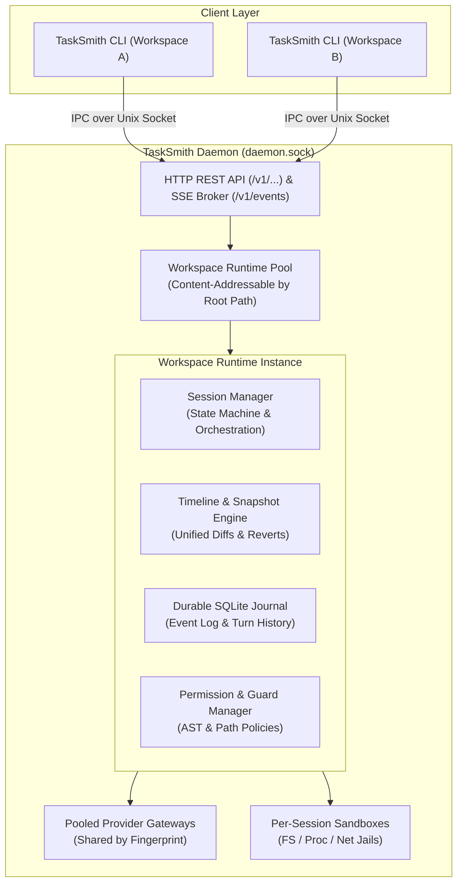

# Daemon Architecture

The **TaskSmith Daemon** is the background service that orchestrates workspaces, manages multi-turn agent sessions, executes tool pipelines, and powers real-time client communication.

---

## 1. Architectural Overview

---

## 2. Core Architectural Design

### 1. Client-Daemon IPC & Multiplexed Event Stream
TaskSmith operates as an on-demand, headless background process listening on a local Unix domain socket (`~/.local/state/tasksmith/daemon.sock`):
- **REST Endpoints**: CLI and external tools issue standard HTTP commands across `/v1/sessions`, `/v1/workspace`, `/v1/permissions`, and `/v1/tasks`.
- **Multiplexed SSE Event Bus**: Clients subscribe to a single Server-Sent Events stream (`GET /v1/events`) powered by an internal publish-subscribe message broker. Real-time token streams, tool start/finish events, interactive permission requests, and background task updates are broadcast concurrently to all connected interfaces without polling.

### 2. Workspace Runtime Pool
The daemon maintains a pool of active workspace runtimes indexed by canonical root path:
- **Workspace Isolation**: Each workspace executes inside its own runtime containing a dedicated session manager, timeline tracker, permission evaluator, and tool container.
- **Zero-Downtime Hot Reloading**: Changes to `.agents/`, `.env`, or workspace configurations trigger automatic in-memory reloads without terminating active sessions.
- **Model Catalog**: Each workspace indexes model manifests at load and lazily merges provider profiles on first access. Reload replaces the catalog; existing model snapshots remain unchanged.
- **Resource De-duplication**: Sibling Git worktrees and independent workspaces sharing identical provider setups automatically share underlying connection pools in the content-addressable Gateway Pool.

### 3. Session State Machine & Durable Journal
Every conversation turn is governed by a strict session lifecycle state machine:
- **Discrete Operational States**: Sessions transition through `idle` $\to$ `running` $\to$ `waiting_permission` (or `waiting_question`) $\to$ `canceling` $\to$ `idle`.
- **Durable Persistence**: All prompt requests, message chunks, assistant reasoning tokens, tool invocations, and user interactions are committed to a local SQLite journal. If the daemon restarts, in-progress turn history and state remain fully recoverable.

### 4. Timeline & File Snapshot Engine
To ensure complete reversibility of AI-driven code edits, the daemon wraps file modifications in a transactional snapshot layer:
- **Before/After Content Capture**: Before any tool (`edit`, `write`, `bash`) mutates a file, the timeline records an immutable snapshot of the original file contents.
- **Instant Unified Diffs**: Clients can query the timeline at any point to render syntax-highlighted diffs across an entire turn or individual tool execution.
- **Atomic File Reverts**: Users can revert specific turns or rollback entire sessions, restoring modified files to their exact pre-turn state on disk.

### 5. Metrics Engine & `daemon.db`
The daemon owns a global SQLite database at `~/.local/share/tasksmith/daemon.db` (`$XDG_DATA_HOME/tasksmith/daemon.db`), opened at startup and closed at shutdown. Its first migration scope is `metrics`, which stores one row per recorded occurrence in `metrics_records` plus any number of named integer values in `metrics_measurements`.
- **Records**: An LLM call (`llm_call`: tokens, nano-USD cost frozen with its pricing tier and a priced flag, latency, time to first token), a tool call (`tool_call`: status and execution duration), or a file change (`file_change`: lines added and removed, written by the session journal for every recorded change, with reverts flagged so views can exclude them). Failed and canceled calls are recorded too. New kinds need no schema change.
- **Attribution**: Each record is attributed from the `scope.Scope` carried in the context: workspace root, session, parent session, turn, message, agent and (for LLM calls) purpose (`chat`, `compaction`, `title`). The assistant message ID is generated before the LLM call so the call is attributed to its message.
- **Write path**: Recording is asynchronous. Records go through a bounded in-memory queue to a batching writer; a full queue drops the record with a warning, recording failures never fail a turn, and shutdown flushes the queue before the database closes.
- **Live totals**: A decorator keeps per-session running totals (loaded from the database on first access) and publishes a `usage_updated` event on the session's stream topic after each record.
- **Queries**: A generic query engine aggregates records for the session, workspace and global usage views and the read-only `/v1/metrics/query`, `/v1/sessions/{id}/usage` and `/v1/usage` endpoints.
- **Retention**: Records outlive their sessions, so historical spend stays accurate after a session is deleted.

### 6. Structured Observability
The daemon provides detailed diagnostics without polluting user terminal outputs:
- Diagnostic events, HTTP request logs, and subsystem errors are written as structured JSON Lines records to `~/.local/state/tasksmith/logs/daemon.jsonl`.
- Session turn failures and LLM error messages are enriched with vendor diagnostics for rapid troubleshooting.
