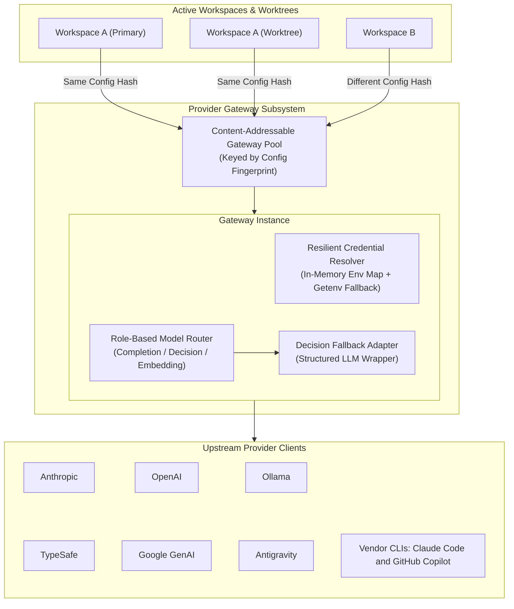

# Gateway Architecture

The **Provider Gateway** is the subsystem in the TaskSmith daemon that manages connections, authentication, and model routing between workspaces and upstream AI providers. For user-facing provider configuration and manifest schemas, see [Providers](../reference/providers.md).

---

## 1. Architectural Overview

---

## 2. Core Architectural Components

### 1. Decoupled Configuration Boundary
The gateway is decoupled from on-disk manifest formats. The workspace catalog resolves model references and role defaults and supplies effective model metadata. Runtime gateway configuration contains:
- Registered provider connection settings (type, endpoint, authentication, headers, and provider options).
- An isolated, in-memory environment map containing workspace secrets.

### 2. Content-Addressable Gateway Pool
Rather than creating a gateway per session or keying gateways by a mutable workspace ID, the daemon maintains a **Content-Addressable Pool** keyed by a deterministic SHA-256 fingerprint of the effective configuration:
- **Automatic De-duplication**: Multiple git worktrees of the same repository—or separate workspaces sharing the same global provider setup—produce the exact same configuration fingerprint and automatically share a single Gateway instance and its underlying HTTP connection pools.
- **Zero-Race Hot Reloading**: When a user edits a provider configuration or rotates an API key, the configuration fingerprint changes automatically. New turns acquire a freshly initialized gateway for the new hash without disrupting in-flight turns on the previous instance.
- **Scoped Hash Inputs**: Only credentials explicitly referenced by a provider's authentication config are included in the fingerprint — the values of referenced environment variables and a content digest of each referenced `${file:...}` credential path. Unrelated environment variables never cause cache misses, and file digests keep secrets out of the hash itself.

### 3. Credential Resolver & Lazy Validation

Provider model browsing uses the configured gateway client. Loom's `llm.ModelLister` supplies a live catalog when implemented. Clients with `ListProfiles` supply their known models as a fallback. The manifest browser uses the bundled preset when the gateway has no catalog.

Automatic profile discovery caches successful catalogs, including misses, and backs off briefly after an error. Workspace loads and reloads pass their cancellation to discovery. Subscription presets declare verified tool and input capabilities directly in their `.provider.yaml` manifests so models retain expected capabilities when live metadata is unavailable.

Interactive provider sign-in is centralized in `gateway/auth.Manager`, which owns PKCE loopback listeners, manual callback parsing, 5-minute flow timeouts, provider-owned browser sign-in commits, unified credential queries (`Account`, `CredentialRevision`, `LoginLabel`, `HasOAuth`, `IsCanonicalBrowserOnly`), and revision-scoped runtime auth-health tracking (`expired_auth` / `invalid_auth`) across both OAuth driver styles. The daemon delegates provider auth endpoints to `auth.Manager`, wires it as the gateway's `AuthObserver`, and supplies a workspace-reload hook on authentication.

The gateway stores browser registrations atomically (`BrowserSessionStore` for token-based flows and `CLISessionStore` for isolated vendor CLI profiles) and shares one refresh source or CLI runtime per active registration. Token-based OAuth transports wrap HTTP round-trips with a single-retry `401` refresh handler (`NewRefreshOnUnauthorizedTransport`) that deduplicates concurrent refreshes before any stream chunks are emitted; unrecoverable `401` or `ErrAuthRequired` failures are classified into `ProviderAuthError` naming the configured TaskSmith provider and cleared automatically on sign-in, logout, credential rotation, or a subsequent successful call. Sign-in changes the gateway fingerprint, token refresh keeps the fingerprint stable, and sign-out invalidates the source. Providers supply their registration type and runtime constructor.

Codex uses Loom for ChatGPT sign-in and keeps the host ID across sign-outs. On a profile cache miss, the gateway asks Loom to look up the model in the account catalog. Loom resolves and caches the resulting profiles. Workspace setup copies the bundled preset.

#### Vendor CLI completion drivers

[Claude Code](../reference/providers/claudecode.md) and [GitHub Copilot](../reference/providers/github-copilot.md) route completions through the installed vendor CLIs on the daemon host. They use the existing provider auth API for browser sign-in on that host, but the vendor CLI handles authentication. Their canonical provider identities and transport settings cannot be overridden by a workspace. Each registration has an isolated profile under TaskSmith's protected credential directory; the CLIs do not inherit vendor tokens or use the host user's normal CLI profiles.

Copilot authentication and inference use the same Copilot SDK v2 `SpawnedStdioConnection` launch configuration. The SDK starts `copilot` directly with an explicit allowlist of child environment variables, without a shell wrapper or an executable launcher in the credential store. Copilot's OS keyring access is explicitly disabled for browser login, SDK compatibility checks, account verification, inference, and vendor logout.

Loom's `SpawnedStdio` starts `claude` directly with an explicit allowlist of child environment variables instead of inheriting the daemon environment. No shell wrapper or temporary launcher is needed. With this explicit environment and no configured auth source directory, Loom does not sync auth files from the host user's `~/.claude` into the isolated profile.

Each active registration has one driver-owned runtime, shared by all gateways using that registration even when their workspace configuration fingerprints differ. Closing a gateway marks only its own API closed (`ErrGatewayClosed`); it does not cancel in-flight API I/O or close the shared runtime. Closing a gateway pool shuts down only that pool's cached gateways. On registration replacement, sign-out, or daemon shutdown, the driver releases the runtime through Loom's native provider `Close` method. Daemon shutdown leaves saved registrations and credentials in place for the next start.

Replacing the registration or signing out invalidates existing gateway clients for that registration. Local sign-out removes the active registration even if the vendor CLI is missing or incompatible. Removing the retired profile and cleaning up vendor credentials are best-effort operations; local sign-out does not guarantee vendor-side revocation.

The vendor CLIs run with native tools and configuration disabled. TaskSmith remains responsible for its own tool execution through the permissions and sandbox layers. Requests are quota-billed, with remaining capacity and reset data surfaced only when the integration has vendor-reported values.

#### HTTP credentials

The gateway resolves HTTP authentication credentials without mutating process state or probing global files:
- **Layered Resolution**: Credentials resolve from the workspace's injected environment map, falling back to process environment variables (`os.Getenv`), or reading from an explicit file path (`${file:...}`), which accepts `~` and paths relative to the declaring provider manifest.
- **Origin boundary**: Redirects on provider HTTP clients must retain the original scheme, hostname, and effective port. A preset's credential binding does not authorize a different origin.
- **Scheme Handling**: The configured scheme (`bearer`, `api-key`, `basic`, `oauth2`, or `none`) decides the header and prefix. The gateway transport is the last layer before the wire, so the configured header always wins over whatever a provider SDK attached, and the SDK's own credential header is removed when it is not the configured one.
- **Graceful Degradation & Per-Provider Fault Isolation**: Providers missing required credentials or declaring an invalid configuration (such as an unknown `auth.type`, unknown provider type, malformed endpoint, or invalid provider-specific config) never abort gateway construction — even when only one provider is configured. Instead, the fault is isolated onto that provider instance, reported as `"invalid_config"` (`⚠ Invalid config`) in `/providers`, skipped during model discovery, and surfaced as a warning in `/warnings` and status-line counts. An error wrapping `ErrInvalidConfig` or `ErrMissingCredential` is raised only when an operation explicitly targets a model on that disabled provider, while remaining healthy providers and workspace endpoints continue operating normally.

### 4. Effective Model Configuration
The workspace model catalog merges Loom profiles with explicit workspace model overrides and resolves requested settings into a configuration and structured diagnostics. Completion models are constructed with the catalog's effective profile, scoped to each model instance so workspace overrides do not alter shared providers. Declared capabilities, limits, modalities and thinking strategies take precedence over the provider profile. Session thinking overrides agent thinking, which overrides the default declared by the model's own thinking capabilities; unsupported agent settings produce diagnostics, while invalid explicit overrides fail validation. A model-declared default that fails validation is ignored rather than reported, because the user never selected it. Explicit temperature support overrides the provider profile; when support is unknown, configured temperature is forwarded with a warning. Known unsupported temperature and Anthropic extended-thinking conflicts are omitted. Session creation, model or agent changes, and workspace reload refresh session diagnostics. Reload stages workspace and gateway changes before publishing them, and session configuration and model construction use a shared reload barrier.

At the provider boundary, request validation rejects known unsupported tools, tool history, input modalities, and response schemas. Structured-output requests with unknown support are forwarded to Loom. Media formats that the adapter would discard are rejected independently of model capabilities. Input blocks that cannot be converted are rejected before entering a session.

### 4a. Metrics Middleware
Every completion model and native decision model the gateway builds carries a metrics middleware that closes over the effective model. For completions it measures time to first token and total duration, keeps the last token metrics reported by the stream, and estimates cost from the model's effective pricing profile (loom attaches cost outside the middleware chain, so the middleware estimates it itself). Native `decision.Provider` calls record duration and any provider-reported token usage via the decision metrics middleware, while adapted `decision.LLMAdapter` calls inherit accounting from the underlying `g.LLM` call so neither path drops or double-counts calls. One `llm_call` record is written when the call ends, fails, is canceled, or is abandoned by the consumer (with `purpose` metadata such as `permission_review` preserved from the call scope); models without pricing are recorded as unpriced. Workspace-defined pricing and tiers are merged into the effective profile by the model catalog and handed to loom, so loom's estimates and the recorded costs agree. The recorder is not part of the gateway configuration fingerprint. See the [Daemon Architecture](./daemon.md) for the metrics engine.

### 5. Triple-Role Model Instantiation & Decision Adapter
Given a resolved `(provider, modelID)` from the workspace layer, the gateway instantiates and adapts models across three cognitive roles:

- **System 1 — Decision (`decision`)**: Evaluates calibrated probabilistic questions (classification, routing, confidence checks).
  - *Native Path*: If the target provider and model support native decision evaluation (e.g., Ollama `nimble-v3`, TypeSafe `jev-latest`, OpenAI decision models), the gateway routes directly to the provider's native decision API.
  - *Adapted Path*: If the target model only supports text completion, the gateway's **Decision Adapter** transparently wraps the completion model using structured outputs so any LLM can act as a System 1 decision engine.
- **System 2 — Completion (`completion`)**: Routes multi-turn reasoning, coding, and tool-calling workloads to chat completion providers.
- **System 3 — Embedding (`embedding`)**: Routes vector generation workloads for semantic search and memory indexing to embedding-capable models.
