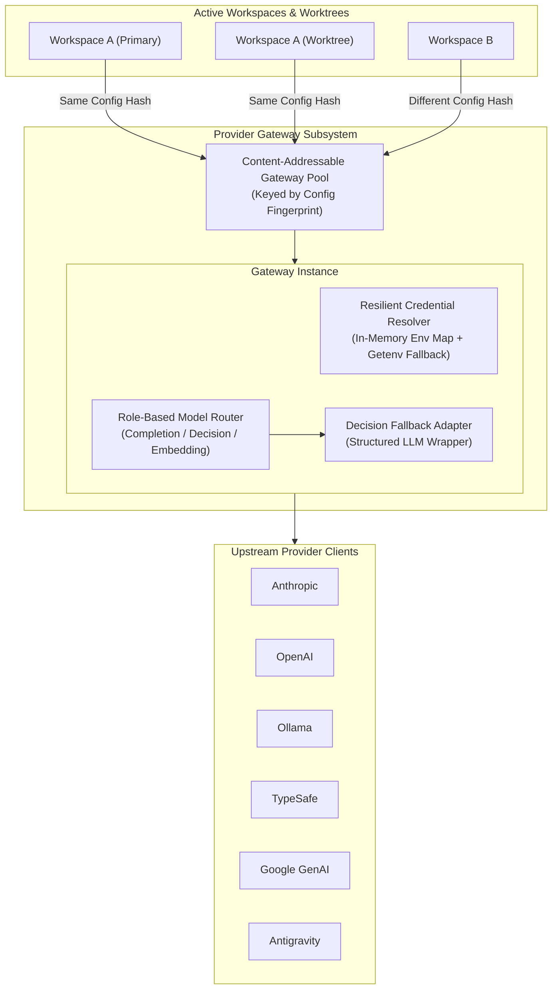

# Gateway Architecture

The **Provider Gateway** is the subsystem in the TaskSmith daemon that manages connections, authentication, and model routing between workspaces and upstream AI providers. For user-facing provider configuration and manifest schemas, see [Providers](../reference/providers.md).

---

## 1. Architectural Overview

---

## 2. Core Architectural Components

### 1. Decoupled Configuration Boundary
The gateway is decoupled from on-disk manifest formats. The workspace layer resolves model references and role defaults and translates provider manifests into a normalized gateway configuration. If workspace resolution does not resolve a qualified model ID, the gateway recognizes its provider prefix only when that provider is registered. Gateway configuration contains:
- Registered providers (endpoints, headers, model catalogs, and capability flags).
- An isolated, in-memory environment map containing workspace secrets.

### 2. Content-Addressable Gateway Pool
Rather than creating a gateway per session or keying gateways by a mutable workspace ID, the daemon maintains a **Content-Addressable Pool** keyed by a deterministic SHA-256 fingerprint of the effective configuration:
- **Automatic De-duplication**: Multiple git worktrees of the same repository—or separate workspaces sharing the same global provider setup—produce the exact same configuration fingerprint and automatically share a single Gateway instance and its underlying HTTP connection pools.
- **Zero-Race Hot Reloading**: When a user edits a provider configuration or rotates an API key, the configuration fingerprint changes automatically. New turns acquire a freshly initialized gateway for the new hash without disrupting in-flight turns on the previous instance.
- **Scoped Hash Inputs**: Only environment variables explicitly referenced by a provider's authentication config are included in the fingerprint; unrelated environment variables never cause cache misses.

### 3. Credential Resolver & Lazy Validation
The gateway resolves authentication credentials without mutating process state or probing global files:
- **Layered Resolution**: Credentials resolve from the workspace's injected environment map, falling back to process environment variables (`os.Getenv`), or reading from an explicit file path (`auth.file`).
- **Lazy Validation**: Providers missing required credentials do not fail gateway initialization at startup. Instead, the provider is flagged with a warning in the CLI header, and an authentication error is only raised when a turn or agent explicitly resolves a model from that provider.

### 4. Effective Model Configuration
The gateway merges the provider's Loom model profile with explicit workspace model overrides and resolves requested settings into a configuration and structured diagnostics. Declared capabilities, limits, modalities and thinking strategies take precedence over the provider profile. Session thinking overrides agent thinking; unsupported agent settings produce diagnostics, while invalid explicit overrides fail validation. Explicit temperature support overrides the provider profile; when support is unknown, configured temperature is forwarded with a warning. Known unsupported temperature and Anthropic extended-thinking conflicts are omitted. Session creation, model or agent changes, and workspace reload refresh session diagnostics. Reload stages workspace and gateway changes before publishing them, and session configuration and model construction use a shared reload barrier.

### 5. Triple-Role Model Instantiation & Decision Adapter
Given a resolved `(provider, modelID)` from the workspace layer, the gateway instantiates and adapts models across three cognitive roles:

- **System 1 — Decision (`decision`)**: Evaluates calibrated probabilistic questions (classification, routing, confidence checks).
  - *Native Path*: If the target provider and model support native decision evaluation (e.g., Ollama `nimble-v3`, TypeSafe `jev-latest`, OpenAI decision models), the gateway routes directly to the provider's native decision API.
  - *Adapted Path*: If the target model only supports text completion, the gateway's **Decision Adapter** transparently wraps the completion model using structured outputs so any LLM can act as a System 1 decision engine.
- **System 2 — Completion (`completion`)**: Routes multi-turn reasoning, coding, and tool-calling workloads to chat completion providers.
- **System 3 — Embedding (`embedding`)**: Routes vector generation workloads for semantic search and memory indexing to embedding-capable models.
