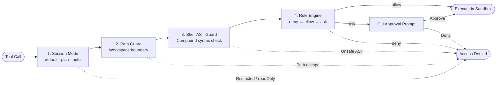
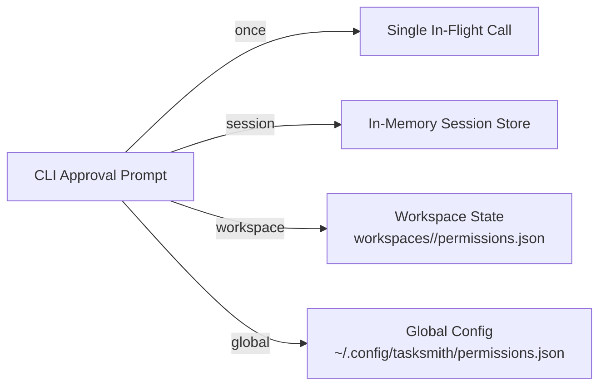

# Permission & Guard Engine

The **Permission & Guard Engine** is the security enforcement subsystem in TaskSmith that controls tool execution, validates shell commands, and prevents unauthorized filesystem or network operations.

---

## 1. Architectural Overview

---

## 2. Core Architectural Design

### 1. Layered Evaluation Pipeline
Every tool call issued by an agent passes through a multi-stage security pipeline before reaching the execution environment:
- **Session Mode & Trust Enforcement**: Separates permission gates (`default`, `accept_edits`, `auto`) from behavioral postures (`plan`, `ask`). `default`, `plan`, and `ask` share the same permission gate (safe read-only tools auto-run; mutating actions prompt), while writes/edits inside `<session-dir>/plans/` always auto-allow. Restricted (untrusted) workspaces start in `default` mode and deny all mutating actions outside `<session-dir>/plans/` regardless of mode. In **Auto Mode** (`auto`), workspace-safe non-destructive operations (and non-unsafe plans matching an allow rule) execute immediately, while `SafetyUnsafe`, unmatched `SafetyOutside`, unmatched `ActionDelete`, `bypass_sandbox` retries, and unlisted proxy hosts return `AccessAsk` so the daemon's calibrated permission reviewer evaluates them once before prompting the human. Explicit `deny` rules and policy exclusions always block immediately.
- **Hierarchical Rule Engine**: Custom permission rules are evaluated in strict priority order: **`deny` $\to$ `allow` $\to$ `ask`**. A matching `deny` rule immediately terminates execution with an error, taking precedence over all other settings.

### 2. Shell AST Inspection (`shellguard`)
Rather than relying on naive regex pattern matching, TaskSmith parses every shell command into an Abstract Syntax Tree (AST):
- **Deep Syntax Decomposition**: Pipelines (`a | b`), sequential commands (`a && b`, `a ; b`), subshells `(a)`, and command substitutions (`$(a)`, `` `a` ``) are unpacked and analyzed individually.
- **Smuggling Prevention**: Attackers cannot bypass guards by hiding dangerous commands inside quoted variables, encoded subshells, or deep pipe chains.
- **Destructive Command Classification**: High-risk system patterns (such as root deletions, raw device writes, and unconfined network downloads piped into shells) are intercepted and rejected before execution.

### 3. Path Confinement & Boundary Guards (`guard`)
File manipulation tools (`view`, `edit`, `write`, `glob`) use workspace boundaries and explicit read-only directories:
- **Built-in resources**: Reads in `$XDG_DATA_HOME/tasksmith/builtin/` are classified safe; writes and deletes are unsafe, including when the directory overlaps the workspace. Permission modes and explicit rules still apply.
- **Path Canonicalization**: Evaluates relative paths and resolves symlinks to ensure targets remain within the workspace root directory.
- **Boundary Validation**: Traversal attempts (`../../etc/passwd`) or symlinks resolving to external files are immediately blocked at the guard layer before reaching the sandbox filesystem capability.

### 4. Scoped Approvals & Persistence

When a tool invocation requires explicit user approval, the interactive prompt allows the user to scope their decision:
- **`once`**: Applies exclusively to the single in-flight tool call.
- **`session`**: Stored in-memory for the duration of the active CLI session, auto-approving matching invocations until exit.
- **`workspace`**: Persisted to the workspace's local state directory (`~/.local/share/tasksmith/workspaces/<hash>/permissions.json`), automatically allowing matching operations in future sessions for that project.
- **`global`**: Configured globally in `~/.config/tasksmith/permissions.json` across all projects on the workstation.

After a user widens the session mode, the daemon rechecks the original tool plans behind pending
prompts in the session and its subagents. It records eligible approvals as `once`, without changing
any rules, and resumes a paused turn only after all of its pending interactions are resolved. Unsafe
requests, explicit sandbox bypasses, and proxy host approvals are not resolved by mode changes.
Tightening the mode does not reject existing prompts.

### 5. Trust Gate & Restricted Mode Boundary
Before any session initializes or executes agent instructions, the directory passes through the **Trust Gate**:
- **Trust Verification (`trust.json`)**: Machine-wide trust records are evaluated from `~/.local/share/tasksmith/trust.json`. Trust can be granted with `folder` scope (exact directory) or `parent` scope (all subdirectories).
- **Executable Configuration Fingerprinting**: TaskSmith computes an SHA-256 digest over executable configuration files (`.agents/tools/*.tool.md`, `.agents/mcps/*.mcp.yaml`, `.agents/decisions/**`, and `.env`). If an upstream checkout modifies these definitions, the fingerprint mismatch invalidates trust and triggers an interactive trust re-prompt.
- **Restricted Mode**: When trust has not been granted or is declined:
  - Custom project tools, project MCP servers, and project `Decision` overrides are omitted or ignored.
  - Workspace `.env` files are ignored, preventing untrusted repositories from harvesting or exfiltrating local environment variables.
  - All file mutations require interactive authorization, and shell execution is strictly restricted.

### 6. Deterministic Context Exclusion
Tool and MCP availability is resolved entirely from workspace manifests before a session assembles any prompt — there is no runtime disabled-list in `permissions.json` (legacy `disabledTools`/`disabledMcps` keys decode but are ignored):
- A resource is unavailable when its own manifest declares `spec.enabled: false` or when `WORKSPACE.md` `spec.policies.tools.exclude` / `spec.policies.mcps.exclude` matches it; a disabled MCP server's discovered tools ride the server's verdict.
- Unavailable tools and servers are pruned from the agent's tool definitions during catalog population, so they never enter the model's token context and the model cannot attempt to invoke them, eliminating hallucinated calls and execution denials.
- Because the verdict is a pure function of checked-in manifests, toggling availability is a manifest write (`spec.enabled` patch or `WORKSPACE.md` exclusion edit), and every client observing the same workspace resolves the same tool set.

### 7. Unsandboxed Execution Namespace
Per-command kernel-sandbox bypasses live in a dedicated permission namespace so ordinary approvals can never authorize them:
- **Namespace isolation**: an unsandboxed bypass plan only matches `bash_unsandboxed(...)` allow rules (or the `*` catch-all); sandboxed plans never match `*_unsandboxed` rules, so granting one variant never widens the other. Deny rules span both namespaces: `bash(git *)` blocks sandboxed and unsandboxed git alike, while `bash_unsandboxed(git *)` denies only the kernel-bypassing variant.
- **Prompt-always**: bypass plans require an explicit matching allow rule in every permission mode, including `auto`; mode-based auto-approval never covers them, and the sandbox backend rejects them outright in read-only posture (`ErrReadOnly`).
- **Excluded commands** (`sandbox.json` `excludedCommands`) take the opposite route: strict AST matching (rejecting redirections, substitutions, dynamic arguments, subshells, `cd`/`eval`, and background operators) marks a plan unsandboxed at execution time while ordinary `bash(...)` rules and modes still decide approval.
- **Runtime posture**: the session pushes a live `RuntimePolicy` (autoAllowBash plus whether the enforced backend is native) into the permission engine on startup and workspace reload, so `autoAllowBash` widens exactly safe, sandboxed bash plans in `default`/`accept_edits` and nothing else.

### 8. Calibrated Decision-Model Review (`permreview`)
In `auto` mode, `AccessAsk` requests from the deterministic engine (`SafetyUnsafe`, unmatched `SafetyOutside`, unmatched `ActionDelete`, `BypassSandbox`, and unlisted proxy `net(host)` plans) pass through `internal/daemon/permreview` before reaching a client prompt:
- **Authority & isolation**: `internal/daemon/permissions` remains synchronous and provider-free. Deterministic `AccessDeny` rules, `WORKSPACE.md` policy ceilings, and `sandbox.json` locks win with zero model calls. A model `approve_once` verdict applies once to that request and never persists rules or domains.
- **Outbound evidence allowlist**: Only allowlisted `api.PermissionRequest` fields (`tool_name`, `action`, `safety`, `target`, `summary`, `diff`, `unsandboxed`, `bypass_sandbox`) and the active turn's initiating user prompt (`user_intent`, capped at 4 KiB) leave the daemon; repository files, `.env`, prior tool outputs, and assistant messages are excluded to block indirect prompt injection. Card evidence exceeding 16 KiB defers locally without truncation or inference.
- **WARP `Decision` resolution & calibration floors**: Resolves `permission-reviewer` across `local > workspace > user > system` (`internal/daemon/workspace/builtin/decisions/permission-reviewer.decision.md`). Go validates that `verdict` offers only `approve_once` and `defer_to_user`, and clamps `threshold = max(manifestThreshold, daemonFloor)` (`0.90` for native `decision.Provider`, `0.95` for `decision.LLMAdapter`), gating approval on `ans.Prob("approve_once") >= threshold` (and optional `minConfidence`).
- **Liveness & single-flight proxy concurrency**: Both harness tool execution and sandbox proxy host approval re-verify turn liveness, `ModeAuto`, and non-`AccessDeny` policy after inference completes. Proxy connections for the same `host|port` coalesce in a silent `reviewing` phase before transitioning to `StatusWaitingPermission` (`prompting`) only on deferral.
