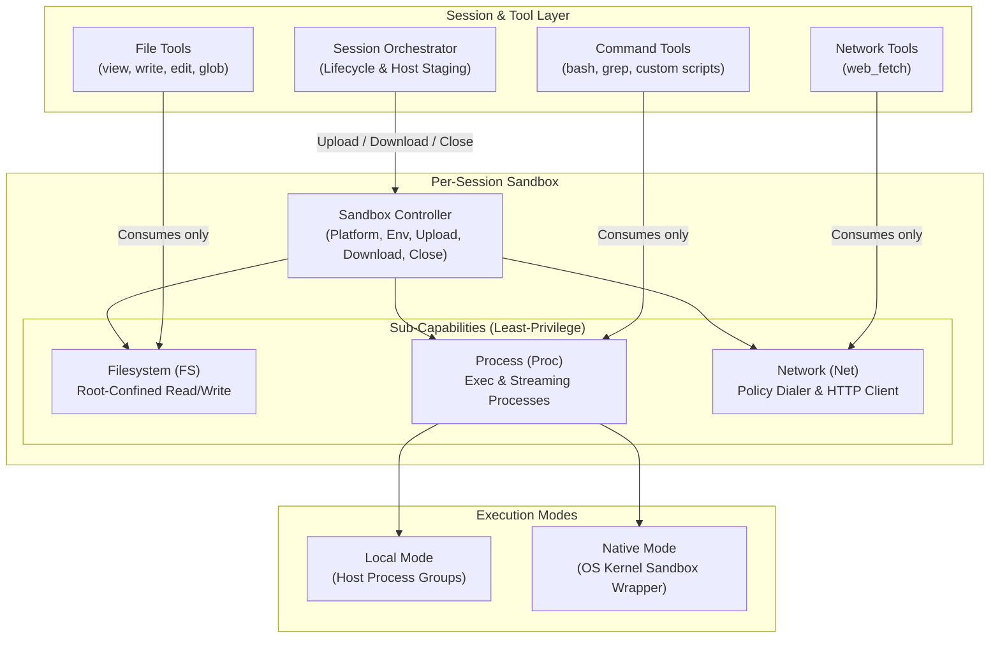

# Sandbox Architecture

The **Sandbox** subsystem is TaskSmith's virtualized operating-system boundary. Every agent session is bound to its own Sandbox instance, ensuring that tools never interact with the host machine directly and all system resources are cleaned up when the session ends.

---

## 1. Architectural Overview

---

## 2. Core Architectural Design

### 1. Pure OS Capability Layer
The sandbox is designed as a pure operating-system abstraction with zero awareness of LLMs, agents, tool schemas, or Git worktrees. It simply takes a root working directory, an execution mode, an environment map, and a network policy, and exposes virtualized OS capabilities. Because it is orthogonal to version control, any directory—whether a primary checkout or an isolated git worktree—can be executed inside any sandbox mode.

### 2. Capability Decomposition (Principle of Least Privilege)
Rather than passing a monolithic sandbox object to every tool, the sandbox is partitioned into three independent sub-capabilities:
- **Filesystem (`FS`)**: Provided only to file-manipulation tools. Confines all reads, writes, directory listings, and metadata lookups to the sandbox's root directory, rejecting path traversals (`../`) and symlink escapes. When configured in **Read-Only** mode, all mutating operations are blocked at the capability boundary.
- **Process (`Proc`)**: Provided only to command and script executors. Supports both synchronous run-to-completion commands and asynchronous streaming processes. Child processes never inherit the daemon's host environment variables; they receive only the sandbox's explicitly configured environment map.
- **Network (`Net`)**: Provided only to network-enabled tools. Enforces outbound connection policies—including full offline mode, domain allowlists/blocklists (with wildcard matching), and loopback blocking to prevent local SSRF—before any socket connection is established.

### 3. Shared Capabilities & Mode-Specific Process Drivers
Decomposing the sandbox into `FS`, `Proc`, and `Net` allows execution modes to share code cleanly:
- **Shared `FS` and `Net`**: Both `local` and `native` modes share the exact same root-jailed filesystem and policy-enforced network implementations.
- **Swappable `Proc` Execution**:
  - **`local` Mode**: Launches child processes inside the confined working directory using isolated process groups.
  - **`native` Mode**: Wraps spawned child processes in the host operating system's native kernel sandbox (Seatbelt on macOS, Bubblewrap on Linux) so that even arbitrary shell commands or third-party binaries cannot write outside the workspace or bypass network restrictions.

### 4. Privileged Host Transfer Boundary (`Upload` & `Download`)
Tools given the `FS` capability can never reference paths outside the sandbox root. However, the daemon occasionally needs to move files between the host and the sandbox (for example, staging a user-attached file from outside the workspace or exporting a build artifact).
- **`Upload` (Host $\to$ Sandbox)** and **`Download` (Sandbox $\to$ Host)** are exposed exclusively on the top-level **Sandbox Controller** held by the session orchestrator, keeping the tool-facing `FS` capability strictly jailed.

### 5. Per-Session Lifecycle & Deterministic Teardown
Each active session owns its Sandbox instance:
- All background and streaming processes started through `Proc` are tracked in an active session registry under isolated process groups.
- When the session finishes or is canceled, closing the sandbox terminates all active process trees, closes idle network connections, and releases underlying filesystem handles—guaranteeing zero leaked background processes across turns.
