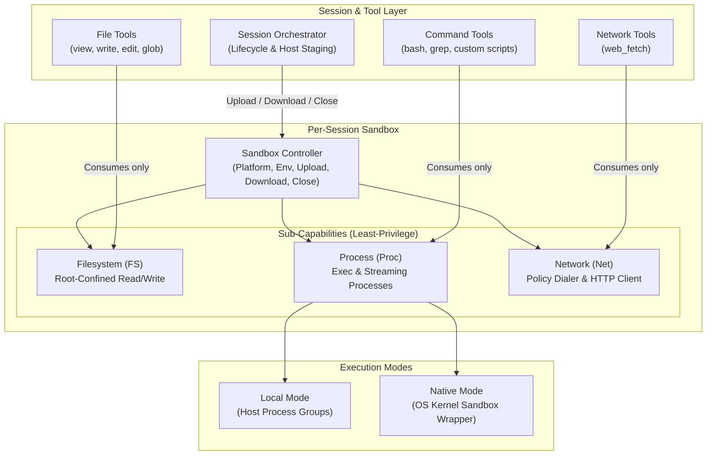

# Sandbox Architecture

The **Sandbox** subsystem is TaskSmith's virtualized operating-system boundary. Every agent session is bound to its own Sandbox instance, ensuring that tools never interact with the host machine directly and all system resources are cleaned up when the session ends.

---

## 1. Architectural Overview

---

## 2. Core Architectural Design

### 1. Pure OS Capability Layer
The sandbox is designed as a pure operating-system abstraction with zero awareness of LLMs, agents, tool schemas, or Git worktrees. It simply takes a root working directory, an execution mode, an environment map, and a network policy, and exposes virtualized OS capabilities. Because it is orthogonal to version control, any directory—whether a primary checkout or an isolated git worktree—can be executed inside any sandbox mode.

### 2. Capability Decomposition (Principle of Least Privilege)
Rather than passing a monolithic sandbox object to every tool, the sandbox is partitioned into three independent sub-capabilities:
- **Filesystem (`FS`)**: Provided only to file-manipulation tools. Confines all reads, writes, directory listings, and metadata lookups to the sandbox's root directory, rejecting path traversals (`../`) and symlink escapes. When configured in **Read-Only** mode, all mutating operations are blocked at the capability boundary.
- **Process (`Proc`)**: Provided only to command and script executors. Supports both synchronous run-to-completion commands and asynchronous streaming processes. Child processes never inherit the daemon's raw environment map directly; they receive only the sandbox's explicitly configured environment map (`Workspace.SubprocessEnv()`), refreshed whenever the workspace reloads. That map preserves the user's host shell environment and trusted workspace `.env` layers so developer CLIs and test suites work normally, while isolating TaskSmith's own private credentials: `$XDG_CONFIG_HOME/tasksmith/.env` (`~/.config/tasksmith/.env`), configured `ModelProvider` `spec.auth.env` variables, and the `TASKSMITH_*` internal namespace stay strictly daemon-side so upstream LLM API keys cannot be exfiltrated from a `bash` call.
- **Network (`Net`)**: Provided only to network-enabled tools. Enforces outbound connection policies—including full offline mode, domain allowlists/blocklists (with wildcard matching), and loopback blocking to prevent local SSRF—before any socket connection is established.

### 3. Shared Capabilities & Mode-Specific Process Drivers
Decomposing the sandbox into `FS`, `Proc`, and `Net` allows execution modes to share code cleanly:
- **Shared `FS` and `Net`**: Both `local` and `native` modes share the exact same root-jailed filesystem and policy-enforced network implementations.
- **Swappable `Proc` Execution**:
  - **`local` Mode**: Launches child processes inside the confined working directory using isolated process groups.
  - **`native` Mode**: Wraps spawned child processes in the host operating system's native kernel sandbox (Seatbelt on macOS, Bubblewrap on Linux) so that even arbitrary shell commands or third-party binaries cannot write outside the workspace or bypass network restrictions.

### 4. Kernel Sandbox Selection & Fallback
The sandbox backend is per-session state, never daemon-wide state: one daemon serves a native session and a local session side by side with zero restarts. Each session resolves its backend at creation:
- **Request**: `tasksmith --sandbox native|local` (passed on `tasksmith`/`repl`) rides on the session creation request and is persisted with the session config. An explicit `local` request is always honored; an explicit `native` request on a host without kernel sandboxing degrades to `local` rather than erroring, so restored sessions and subagents never fail to start.
- **Default**: with no request, sessions prefer `native` whenever the host kernel backend is usable and transparently fall back to `local` otherwise. Usability is decided by a cached one-shot probe that actually attempts to create a sandbox (`sandbox-exec -p '(allow default)' true` on macOS, a minimal `bwrap --unshare-pid` namespace on Linux), not just by binary presence — so unprivileged containers, AppArmor-restricted user-namespace hosts, and nested-sandbox parents degrade to `local` instead of failing every command.
- **Inheritance & immutability**: subagents inherit the backend their parent's sandbox actually enforces — and persist it in their own config, so a daemon restart restores them on the same backend even before parent links are rewired — and the backend cannot be changed after creation (updates requesting a different backend are rejected; updates repeating the effective backend are no-ops).
- **Surfacing**: both the workspace representation (default mode for draft sessions) and the session representation (resolved mode for active sessions) report the sandbox backend shown in the REPL header beside the workspace path, while `Workspace.Warnings` carries the fallback warning whenever kernel sandboxing is unavailable on the host.

### 5. Two-Level Kernel Read-Only Enforcement
Read-only kernel enforcement is deliberately decoupled from the session's permission mode:
- **Session level (`Sandbox.SetReadOnly`)**: The workspace root becomes read-only inside the kernel profile whenever the workspace is restricted (untrusted repository) or the effective workspace/agent `policies.tools.readOnly` policy is true (evaluated on the resolved agent, so policies inherited through skills and workspace ceilings count, and inherited by subagents from their parent's sandbox). Toggling the policy affects subsequent executions, not already-running children.
- **Per-command (`Command.ReadOnly`)**: Whenever an authorized permission plan reports `ReadOnly == true` — in any permission mode — the individual `bash` or custom-tool invocation runs under a read-only kernel profile as defense-in-depth: if `shellguard` or an `isReadOnly` annotation misclassifies a mutating command, the kernel still blocks the write.

### 6. Host Credential Protection in `native` Mode
Seatbelt and Bubblewrap profiles mask sensitive host credential locations outside the workspace using the same canonical source of truth (`guard.HostCredentialPaths`) that `shellguard` enforces at the AST layer: every entry in `guard.DefaultSensitiveHomeDirs` (`~/.ssh`, `~/.aws`, `~/.gnupg`, `~/.kube`, `~/.docker`, `~/.netrc`) plus TaskSmith's own global secret stores (`$XDG_CONFIG_HOME/tasksmith/.env`, `$XDG_DATA_HOME/tasksmith/credentials`, and `$XDG_DATA_HOME/tasksmith/mcp`). Candidates are masked even before they exist, so secrets created mid-session (an OAuth login or `/setup` writing the credential stores) land behind an already-active kernel rule. Seatbelt emits trailing `(deny file-read* (subpath …))` rules (last-match wins over the blanket read allow); Bubblewrap masks directories with `--tmpfs` and single files with a `/dev/null` read-only bind. Paths are canonicalized through the deepest existing ancestor before matching — so rules sit on the kernel's canonical vnode path even when a parent is a symlink (`/var` → `/private/var` on macOS) — and any candidate overlapping the canonical workspace root is skipped, keeping a dotfiles workspace whose `~/.ssh` symlinks into it readable. Session sandboxes and the daemon's workspace file-indexer sandbox (which executes `git`/`rg` inside the repository) both receive these masks.

### 7. Privileged Host Transfer Boundary (`Upload` & `Download`)
Tools given the `FS` capability can never reference paths outside the sandbox root. However, the daemon occasionally needs to move files between the host and the sandbox (for example, staging a user-attached file from outside the workspace or exporting a build artifact).
- **`Upload` (Host $\to$ Sandbox)** and **`Download` (Sandbox $\to$ Host)** are exposed exclusively on the top-level **Sandbox Controller** held by the session orchestrator, keeping the tool-facing `FS` capability strictly jailed.

### 8. Per-Session Lifecycle & Deterministic Teardown
Each active session owns its Sandbox instance:
- All background and streaming processes started through `Proc` are tracked in an active session registry under isolated process groups.
- When the session finishes or is canceled, closing the sandbox terminates all active process trees, closes idle network connections, and releases underlying filesystem handles—guaranteeing zero leaked background processes across turns.

### 9. Trust Boundary & Restricted Execution
When a workspace operates in **Restricted Mode** (untrusted repository or unconfirmed trust prompt), the sandbox tightens capability boundaries:
- **Environment Isolation**: Workspace-level `.env` files are not loaded into the sandbox environment map, preventing untrusted repositories from accessing or exfiltrating sensitive environment keys.
- **Process & Tool Restriction**: Custom project tools (`.agents/tools/`) and project MCP server processes (`.agents/mcps/`) are not initialized or spawned in the process manager.
- **Kernel Read-Only**: The sandbox is switched to read-only enforcement (see Two-Level Kernel Read-Only Enforcement above), preventing unvetted scripts from altering project code without inspection.
