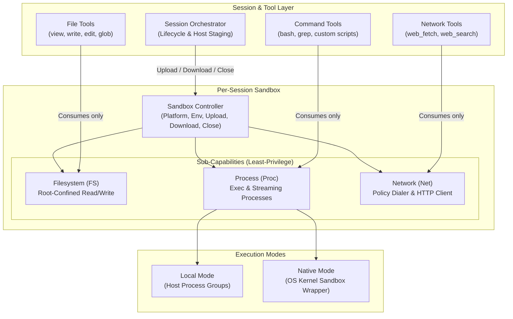

# Sandbox Architecture

The **Sandbox** subsystem is TaskSmith's virtualized operating-system boundary. Every agent session is bound to its own Sandbox instance, ensuring that tools never interact with the host machine directly and all system resources are cleaned up when the session ends.

---

## 1. Architectural Overview

---

## 2. Core Architectural Design

### 1. Pure OS Capability Layer
The sandbox is designed as a pure operating-system abstraction with zero awareness of LLMs, agents, tool schemas, or Git worktrees. It simply takes a root working directory, an execution mode, an environment map, and a network policy, and exposes virtualized OS capabilities. Because it is orthogonal to version control, any directory—whether a primary checkout or an isolated git worktree—can be executed inside any sandbox mode.

### 2. Capability Decomposition (Principle of Least Privilege)
Rather than passing a monolithic sandbox object to every tool, the sandbox is partitioned into three independent sub-capabilities:
- **Filesystem (`FS`)**: Provided only to file-manipulation tools. Confines all reads, writes, directory listings, and metadata lookups to the sandbox's root directory, rejecting path traversals (`../`) and symlink escapes. When configured in **Read-Only** mode, all mutating operations are blocked at the capability boundary.
- **Process (`Proc`)**: Provided only to command and script executors. Supports both synchronous run-to-completion commands and asynchronous streaming processes. Child processes never inherit the daemon's raw environment map directly; they receive only the sandbox's explicitly configured environment map (`Workspace.SubprocessEnv()`), refreshed whenever the workspace reloads. That map preserves the user's host shell environment and trusted workspace `.env` layers so developer CLIs and test suites work normally, while isolating TaskSmith's own private credentials: `$XDG_CONFIG_HOME/tasksmith/.env` (`~/.config/tasksmith/.env`), variables referenced by configured `ModelProvider` `spec.auth` `${env:...}` expressions, and the `TASKSMITH_*` internal namespace stay strictly daemon-side so upstream LLM API keys cannot be exfiltrated from a `bash` call.
- **Network (`Net`)**: Provided only to network-enabled tools. Enforces outbound connection policies—including full offline mode, domain allowlists/blocklists (with wildcard matching), and loopback blocking to prevent local SSRF—before any socket connection is established.

#### Subprocess Network Allowlist Proxy

Under the `allowlist` network posture in **`native`** mode, child processes never hold a direct route to the network. The sandbox starts a daemon-side HTTP + `CONNECT` proxy on an ephemeral loopback port and:

- **Confines the kernel profile** to the proxy: the Seatbelt profile replaces `(allow network*)` with outbound permission only to the proxy's loopback port, and on Linux the network namespace stays closed (`--unshare-net`) with a hidden in-namespace relay bridging the child's loopback proxy port to a Unix socket the daemon proxy binds inside the sandbox temp dir.
- **Injects `HTTP_PROXY`/`HTTPS_PROXY`/`ALL_PROXY` (plus lowercase variants) with an empty `NO_PROXY`** into every confined child environment, so proxy-aware tooling is routed automatically and cannot opt out; anything attempting a direct connection is blocked by the kernel profile.
- **Evaluates every target hostname** against `DeniedDomains` (always refused, winning over everything) and `AllowedDomains` (exact hosts, `*.domain` wildcards, and IP literals — IPv4 or IPv6, bracketed `[::1]` accepted; wildcards never apply to IP literals). Denied and — when no approval callback exists — unlisted hosts receive `403` from the proxy itself. Forwarded requests carry the allowlisted authority as their `Host` header, so a mismatched `Host:` cannot smuggle traffic to a blocked virtual host behind an allowed front.
- **Resolves DNS daemon-side and dials the checked IP directly** (no second lookup, closing the DNS-rebinding window), refusing any target that is or resolves to a reserved address: loopback (`127.0.0.0/8`, `::1`), the entire `0.0.0.0/8` "this network" block, link-local/multicast — including the `169.254.169.254` and `fd00:ec2::254` cloud metadata endpoints. Listing the literal IP itself in `allowedDomains` is the only way to open a reserved address; wildcards never do, and an interactive approval never waives this — approving a hostname only puts it on the same footing as an `allowedDomains` entry, so a single Allow-once click on an attacker-chosen domain cannot reach loopback or cloud metadata. RFC1918 space is intentionally permitted, since private networks legitimately host allowed domains.
- **Fails closed**: an active allowlist posture whose proxy is not running (startup bind failure, socket-path limit) yields no network at all — the kernel wrapper refuses to launch the child rather than falling back to open networking.
- **Escalates unlisted hosts to the user** through an optional `OnUnlistedHost` callback. The session wires it to the permission engine as an `ActionNet` plan: existing `net(host)` allow rules (the only silent auto-approval — no permission mode, including `auto`, may silently open an unlisted host), deny rules, and policy ceilings decide silently where they can, and a genuine ask prompts in the attached REPL. One-shot and session grants persist as in-memory `net(host)` rules; "Allow for workspace"/global grants append the host to the corresponding `sandbox.json` `network.allowedDomains` and live-refresh the proxy policy. The prompt runs mid-turn without disturbing the running turn (the session shows `waiting_permission` while the subprocess stays executing), coalesces concurrent connections to one prompt per `host:port`, is visible to reconnecting clients, and is released when the session closes or the turn is cancelled. With no client attached, or after a two-minute timeout, the host is refused immediately. An agent's `policies.tools.include` allow-list never silently denies these synthetic network plans — egress rides on the already-approved tool — though `openWorld: deny` still does.

### 3. Shared Capabilities & Mode-Specific Process Drivers
Decomposing the sandbox into `FS`, `Proc`, and `Net` allows execution modes to share code cleanly:
- **Shared `FS` and `Net`**: Both `local` and `native` modes share the exact same root-jailed filesystem and policy-enforced network implementations.
- **Swappable `Proc` Execution**:
  - **`local` Mode**: Launches child processes inside the confined working directory using isolated process groups.
  - **`native` Mode**: Wraps spawned child processes in the host operating system's native kernel sandbox (Seatbelt on macOS, Bubblewrap on Linux) so that even arbitrary shell commands or third-party binaries cannot write outside the workspace or bypass network restrictions.

### 4. Kernel Sandbox Selection & Fallback
The sandbox backend is per-session state, never daemon-wide state: one daemon serves a native session and a local session side by side with zero restarts. Each session resolves its backend at creation:
- **Request**: `tasksmith --sandbox native|local` (passed on `tasksmith`/`repl`) rides on the session creation request and is persisted with the session config. An explicit `local` request is always honored; an explicit `native` request on a host without kernel sandboxing degrades to `local` rather than erroring, so restored sessions and subagents never fail to start.
- **Default**: with no request, sessions prefer `native` whenever the host kernel backend is usable and transparently fall back to `local` otherwise. Usability is decided by a cached one-shot probe that actually attempts to create a sandbox (`sandbox-exec -p '(allow default)' true` on macOS, a minimal `bwrap --unshare-pid` namespace on Linux), not just by binary presence — so unprivileged containers, AppArmor-restricted user-namespace hosts, and nested-sandbox parents degrade to `local` instead of failing every command.
- **Inheritance & immutability**: subagents inherit the backend their parent's sandbox actually enforces — and persist it in their own config, so a daemon restart restores them on the same backend even before parent links are rewired — and the backend cannot be changed after creation (updates requesting a different backend are rejected; updates repeating the effective backend are no-ops).
- **Surfacing**: both the workspace representation (default mode for draft sessions) and the session representation (resolved mode for active sessions) report the sandbox backend shown in the REPL header beside the workspace path. `Workspace.SandboxWarnings` (`sandbox_warnings`) is the sandbox-specific subset of `Workspace.Warnings`, including native sandbox fallback warnings when applicable. The REPL shows that subset in the header and counts it as part of the full warning list in `/warnings`.

### 5. Two-Level Kernel Read-Only Enforcement
Read-only kernel enforcement is deliberately decoupled from the session's permission mode:
- **Session level (`Sandbox.SetReadOnly`)**: The workspace root becomes read-only inside the kernel profile whenever the workspace is restricted (untrusted repository) or the effective workspace/agent `policies.tools.readOnly` policy is true (evaluated on the resolved agent, so policies inherited through skills and workspace ceilings count, and inherited by subagents from their parent's sandbox). Toggling the policy affects subsequent executions, not already-running children.
- **Per-command (`Command.ReadOnly`)**: Whenever an authorized permission plan reports `ReadOnly == true` — in any permission mode — the individual `bash` or custom-tool invocation runs under a read-only kernel profile as defense-in-depth: if `shellguard` or an `isReadOnly` annotation misclassifies a mutating command, the kernel still blocks the write.

### 6. Host Credential Protection in `native` Mode
Seatbelt and Bubblewrap profiles mask sensitive host credential locations outside the workspace using the same canonical source of truth (`guard.HostCredentialPaths`) that `shellguard` enforces at the AST layer: every entry in `guard.DefaultSensitiveHomeDirs` (`~/.ssh`, `~/.aws`, `~/.gnupg`, `~/.kube`, `~/.docker`, `~/.netrc`) plus TaskSmith's own global secret stores (`$XDG_CONFIG_HOME/tasksmith/.env`, `$XDG_DATA_HOME/tasksmith/credentials`, and `$XDG_DATA_HOME/tasksmith/mcp`). Candidates are masked even before they exist, so secrets created mid-session (an OAuth login or `/setup` writing the credential stores) land behind an already-active kernel rule. Seatbelt emits trailing `(deny file-read* (subpath …))` rules (last-match wins over the blanket read allow); Bubblewrap masks directories with `--tmpfs` and single files with a `/dev/null` read-only bind. Paths are canonicalized through the deepest existing ancestor before matching — so rules sit on the kernel's canonical vnode path even when a parent is a symlink (`/var` → `/private/var` on macOS) — and any candidate overlapping the canonical workspace root is skipped, keeping a dotfiles workspace whose `~/.ssh` symlinks into it readable. Session sandboxes and the daemon's workspace file-indexer sandbox (which executes `git`/`rg` inside the repository) both receive these masks.

### 7. Protected Write Paths Inside the Workspace
A writable `native` workspace is not a fully writable workspace: `shellguard` classifies `.agents`/`.git` mutations as unsafe at the shell AST layer, but a sandboxed binary (`python`, `go test`, `node`) could previously still write those paths directly. Seatbelt and Bubblewrap profiles therefore close the kernel gap using `guard.ProtectedWorkspaceWritePaths(workDir)`, which is applied as a non-overridable `DeniedWritePaths` list on every session sandbox and the workspace file-indexer sandbox:
- **Agent resources**: `<workspace-root>/.agents` and `<workspace-root>/WORKSPACE.md`, so a sandboxed process can never rewrite the rules, skills, or manifest governing its own next invocation.
- **Git tampering surfaces**: `<workspace-root>/.git/hooks` and `<workspace-root>/.git/config`, blocking hook injection and repo-config hijacking.
- **Shell/Git startup dotfiles**: `<workspace-root>/.bashrc`, `.zshrc`, `.profile`, `.gitconfig`.
- **TaskSmith's own stores**: `$XDG_CONFIG_HOME/tasksmith` and `$XDG_DATA_HOME/tasksmith` (which hold `sandbox.json` and `permissions.json`), so a sandboxed process can never escalate its own next invocation.

Seatbelt emits these as trailing `(deny file-write* (subpath …))` rules — after every write allow, since Seatbelt resolves by last-match — in both logical and symlink-resolved form; Bubblewrap overlays `--ro-bind` mounts for each existing protected path after the writable binds, so the read-only mount wins inside the namespace. Workspace entries are anchored under both the logical and the symlink-resolved workspace root without dereferencing the leaf, so a repository that symlinks a protected location (e.g. `.git/hooks -> ../.githooks`) keeps the symlink entry itself read-only: a sandboxed process can neither write the target nor unlink and replace the symlink. Reads of protected paths stay allowed; only writes are denied.

### 8. Linked Git Worktrees in `native` Mode
Subagents spawned with `workspace: "worktree"` run inside a linked git worktree, where `<worktree>/.git` is a pointer file into the shared common git directory (`<main-repo>/.git`) that lives **outside** the sandbox root. Without special handling, `git add`/`git commit` fail because the kernel profile denies writes to the common dir. At session sandbox initialization (and on workspace reload), the session detects the linked-worktree topology via `internal/core/vcs` and:
- adds `<main-repo>/.git` to `ExtraWritePaths`, so `git status`, `git add`, and `git commit` work inside the worktree;
- adds `<main-repo>/.git/hooks` and `<main-repo>/.git/config` to `DeniedWritePaths`, so the shared repository's hooks and config stay tamper-proof even though the rest of the common dir is writable.

Normal checkouts, plain directories, and bare hubs are unaffected: their Git state already lives inside (or entirely outside) the sandbox root.

Path confinement beyond the workspace root is expressed as a structured `sandbox.FilesystemPolicy` (`DeniedReadPaths`, `AllowReadPaths`, `ExtraWritePaths`, `DeniedWritePaths`) carried on `sandbox.Config` and swappable at runtime through `Sandbox.SetFilesystemPolicy`, so updated rules take effect on the very next command in an active session without recreating the sandbox. Read rules are emitted broadest-path-first (narrower `AllowReadPaths` entries re-open subtrees a broader `DeniedReadPaths` mask covers; narrower denies re-mask secrets inside them, and deny wins an exact-tie prefix). The sandbox's own operational roots — the work dir, temp dir, and extra write paths — are always implicitly re-opened at their own breadth after any broader mask, so a posture like `denyRead: ["~"]` with the workspace inside the home directory still leaves the session able to read and write its workspace; a mask placed at exactly one of those roots is an explicit user deny and suppresses that implicit re-open. Bubblewrap builds one breadth-sorted mount plan in which writable binds land after any tmpfs mask covering them and protected read-only overlays land after every writable bind, and drops writable or overlay mounts that would otherwise leak host contents strictly inside a masked subtree no root re-opened.

### 9. The `sandbox.json` Configuration Layer

Isolation posture is user-configurable through a two-scope `sandbox.json` layer managed by `internal/daemon/sandboxcfg`, mirroring the storage layout of `permissions.json` while keeping the concerns independent: `permissions.json` decides *whether* a tool call requires approval; `sandbox.json` decides *what* the OS isolation permits.

| Scope | Portable Path | Purpose |
| :--- | :--- | :--- |
| `global` | `$XDG_CONFIG_HOME/tasksmith/sandbox.json` | User-wide defaults, personal `excludedCommands`, global path rules, and workstation-wide locks. |
| `project` | `$XDG_DATA_HOME/tasksmith/workspaces/<hash>/sandbox.json` | Workspace-specific overrides managed via the daemon API; never committed to git. |

Effective settings follow the workspace trust boundary:

- **Backend default**: `SessionConfig.Sandbox` (per-request) > `project.mode` > `global.mode` > platform default. A session that requests no backend inherits the configured default.
- **Monotonic locks**: `failIfUnavailable` is OR-merged (any scope enabling it can never be relaxed by the other; with it active, a native request on a host without kernel sandboxing fails session creation with `sandbox.ErrNativeUnavailable` instead of silently degrading to `local`). `allowUnsandboxed` is AND-merged (a global or project `false` locks the escape hatch off) and is forced `false` in restricted workspaces.
- **Arrays** (`excludedCommands`, `filesystem.*`) are deduplicated unions; project-relative paths resolve against the workspace root, `~` expands to the user's home, and non-`~` relative paths are rejected in the global scope. `excludedCommands` is additionally cleared whenever the `allowUnsandboxed` hatch is locked off (restricted workspace or any scope pinning it `false`), since exclusions are one more route onto the host without the kernel wrapper.
- **Path overlap**: writes resolve as built-in protected floor > user `denyWrite` > user `allowWrite`; reads resolve narrower-prefix-wins with deny taking exact ties. TaskSmith's own secret stores (`$XDG_CONFIG_HOME/tasksmith/.env`, `$XDG_DATA_HOME/tasksmith/credentials`, `$XDG_DATA_HOME/tasksmith/mcp`) can never be re-opened through `allowRead`.
- **Self-protection**: files are written atomically at `0600`, and `guard.IsSensitiveWritePath` marks `sandbox.json` and the `workspaces/` store `SafetyUnsafe` for every non-read tool action, so a sandboxed or tool-driven process can never rewrite the isolation posture of the next invocation.

Repository-committed manifests (`WORKSPACE.md`, `.agents/`) may only narrow these scopes, never widen them. The merged posture is computed once per session at creation and re-applied live through `Sandbox.SetFilesystemPolicy` on workspace reload, so edits apply to running sessions without recreating the sandbox.

Clients read and manage the layer through the workspace-scoped daemon API: `GET /v1/sandbox` returns the stored `global`/`project` scopes, the effective merge, the canonical resolved path lists, whether the workspace is restricted (which forces `allowUnsandboxed` off), and a host backend availability probe (backend name `seatbelt`/`bubblewrap`, the cached probe result, and remediation guidance when the backend is unavailable — e.g. installing bubblewrap or lifting Ubuntu's AppArmor unprivileged-userns restriction). `PUT /v1/sandbox` validates and atomically overwrites one scope, then refreshes every open session's kernel path policy so the edit applies to the very next command; a global-scope write refreshes sessions across all workspaces the daemon hosts.

### 10. Privileged Host Transfer Boundary (`Upload` & `Download`)
Tools given the `FS` capability can never reference paths outside the sandbox root. However, the daemon occasionally needs to move files between the host and the sandbox (for example, staging a user-attached file from outside the workspace or exporting a build artifact).
- **`Upload` (Host → Sandbox)** and **`Download` (Sandbox → Host)** are exposed exclusively on the top-level **Sandbox Controller** held by the session orchestrator, keeping the tool-facing `FS` capability strictly jailed.

### 11. Per-Session Lifecycle & Deterministic Teardown
Each active session owns its Sandbox instance:
- All background and streaming processes started through `Proc` are tracked in an active session registry under isolated process groups.
- When the session finishes or is canceled, closing the sandbox terminates all active process trees, closes idle network connections, and releases underlying filesystem handles—guaranteeing zero leaked background processes across turns.

### 12. Trust Boundary & Restricted Execution
When a workspace operates in **Restricted Mode** (untrusted repository or unconfirmed trust prompt), the sandbox tightens capability boundaries:
- **Environment Isolation**: Workspace-level `.env` files are not loaded into the sandbox environment map, preventing untrusted repositories from accessing or exfiltrating sensitive environment keys.
- **Process & Tool Restriction**: Custom project tools (`.agents/tools/`) and project MCP server processes (`.agents/mcps/`) are not initialized or spawned in the process manager.
- **Kernel Read-Only**: The sandbox is switched to read-only enforcement (see Two-Level Kernel Read-Only Enforcement above), preventing unvetted scripts from altering project code without inspection.
