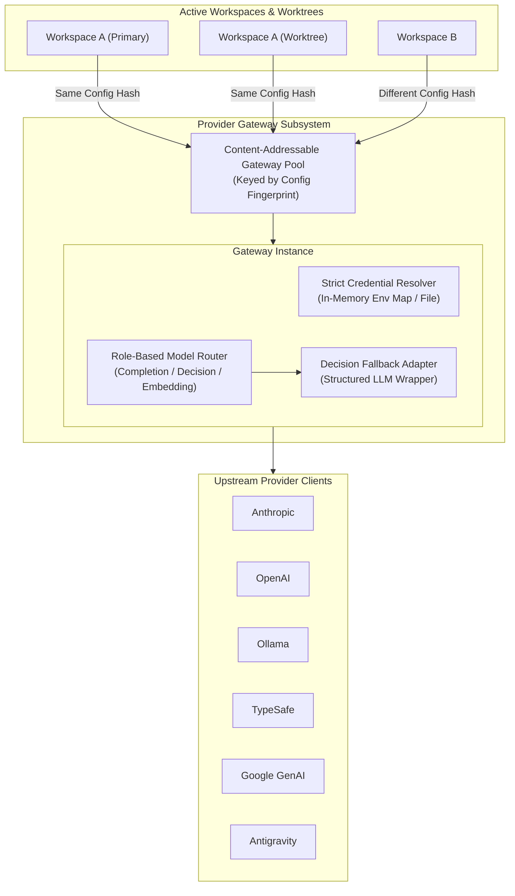

# Gateway Architecture

The **Provider Gateway** is the subsystem in the TaskSmith daemon that manages connections, authentication, and model routing between workspaces and upstream AI providers.

---

## 1. Architectural Overview

---

## 2. Core Architectural Components

### 1. Decoupled Configuration Boundary
The gateway is completely decoupled from on-disk manifest formats. The workspace layer parses declarative configuration files and translates them into a normalized gateway configuration containing:
- Registered providers (endpoints, headers, model catalogs, and capability flags).
- Role-based default model mappings.
- An isolated, in-memory environment map containing workspace secrets.

### 2. Content-Addressable Gateway Pool
Rather than creating a gateway per session or keying gateways by a mutable workspace ID, the daemon maintains a **Content-Addressable Pool** keyed by a deterministic SHA-256 fingerprint of the effective configuration:
- **Automatic De-duplication**: Multiple git worktrees of the same repository—or separate workspaces sharing the same global provider setup—produce the exact same configuration fingerprint and automatically share a single Gateway instance and its underlying HTTP connection pools.
- **Zero-Race Hot Reloading**: When a user edits a provider configuration or rotates an API key, the configuration fingerprint changes automatically. New turns acquire a freshly initialized gateway for the new hash without disrupting in-flight turns on the previous instance.
- **Scoped Hash Inputs**: Only environment variables explicitly referenced by a provider's authentication config are included in the fingerprint; unrelated environment variables never cause cache misses.

### 3. Strict Credential Resolver
To guarantee deterministic behavior and prevent secret leakage, the gateway enforces strict authentication rules:
- **No Global Environment Probing**: The gateway never reads the daemon process's global environment or searches the filesystem for undeclared `.env` files.
- **Explicit Resolution**: Each provider declares whether its credential comes from a named key in the injected environment map or an explicit credential file path, and how it is attached (`Bearer`, `API-Key`, or `Basic` auth headers). If a required credential is missing, gateway initialization fails immediately.

### 4. Triple-Role Model Router & Decision Adapter
The gateway routes requests across three cognitive roles following a strict fallback chain (**Explicit Override $\to$ Workspace Role Default $\to$ Provider Role Default $\to$ Catalog Capability Match**):

- **System 1 — Decision (`decision`)**: Evaluates calibrated probabilistic questions (classification, routing, confidence checks).
  - *Native Path*: If the target provider and model support native decision evaluation (e.g., Ollama `nimble-v3`, TypeSafe `jev-latest`, OpenAI decision models), the gateway routes directly to the provider's native decision API.
  - *Adapted Path*: If the target model only supports text completion, the gateway's **Decision Adapter** transparently wraps the completion model using structured outputs so any LLM can act as a System 1 decision engine.
- **System 2 — Completion (`completion`)**: Routes multi-turn reasoning, coding, and tool-calling workloads to chat completion providers.
- **System 3 — Embedding (`embedding`)**: Routes vector generation workloads for semantic search and memory indexing to embedding-capable models.
