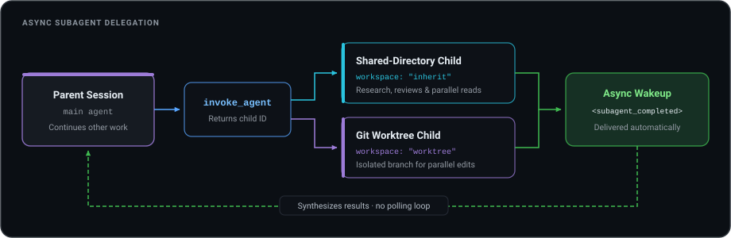

# Delegate work to specialized agents

Give research, implementation and review to separate agents while keeping
one parent conversation responsible for the result. Create a custom agent
when a recurring job needs its own instructions or tool restrictions.

## Use built-in agents

| Agent | Give it this job | What you get back |
| --- | --- | --- |
| `main` | Coordinate a feature from request to verification. | The user-facing conversation and a synthesis of child results. |
| `explore` | Locate a code path or trace where a setting is used. | Read-only research with file locations. |
| `general` | Implement a bounded change or run independent checks. | A summary of changes and verification from an execution agent. |
| `code-reviewer` | Review a diff, commit, branch or pull request. | Read-only findings using the effective `code-review` skill. |

Try a prompt with a clear boundary between workers:

```text
Have explore trace how the importer handles blank lines. Meanwhile, inspect
the documented input format yourself. Compare the two; don't modify files.
```

For an independent review, you don't need to compose a delegation prompt:

```text
/review HEAD~1..HEAD
```

The command supplies both a clean conversation and a reviewer. To customize
what counts as a finding, change the shared `code-review` skill rather than
duplicating review instructions in every calling command.

## Follow a delegated task from launch to completion



The parent gives `invoke_agent` an agent name, a short title and a complete
brief. The tool returns a child session ID and working directory immediately.
The parent can do other work; the child sends an asynchronous
`<subagent_completed>` message with its result. No polling loop is needed.

Choose the **working directory** separately from the conversation context:

| `workspace` | Choose it when… | Watch for |
| --- | --- | --- |
| `inherit` (default) | A reader needs to inspect the current working files. | Writes are visible to the parent. Avoid assigning overlapping edits. |
| `worktree` | A writer needs a separate Git checkout. | Review the child's changes in its reported directory; don't assume they're in the parent checkout. |

For example, the parent's tool call for a shared-directory reader can be:

```json
{
  "agent": "explore",
  "title": "Trace importer validation",
  "prompt": "Find where blank input lines are accepted or rejected. Return file and line references without editing.",
  "workspace": "inherit"
}
```

Name the outputs you need. “Return the failing test name and the observed
error” lets the parent distinguish a diagnosis from a verified fix.

## Inspect and manage running subagents

In the composer, open:

```text
/subagents
```

Press `a` to include idle children and `Enter` to inspect the selected one.
The model badge is the **resolved model**, not the alias in the request.
Use the latest output and working directory to decide whether a follow-up
belongs with the same child or in the parent session.

The parent uses `manage_agents` for these operations:

| Action | When to use it |
| --- | --- |
| `list` | Find child session IDs, states and directories. |
| `status` | Read a particular child's state and latest response by `session_id`. |
| `send` | Give the child a follow-up `message` with its `session_id`. |
| `kill` | Stop that child when the work is no longer needed. |
| `models` | Find models that satisfy an agent's allowlist before requesting an override. |

For example, inspect eligible models without launching another session:

```json
{ "action": "models", "agent": "general", "query": "@smart" }
```

`send` and `kill` can require approval. Stopping a child is not an undo
operation: inspect any changes it already made.

## Create a custom agent (`*.agent.md`)

Create the directory at the project root:

```sh
mkdir -p .agents/agents
```

Save this as `.agents/agents/api-reader.agent.md`:

```markdown
---
apiVersion: warp/v1alpha1
kind: Agent
metadata:
  name: api-reader
  displayName: API Contract Reader
  description: Traces public request validation and reports contract mismatches.
spec:
  triggers: [human, agent]
  models: ["@smart", "@inherit", "ollama/*"]
  tools: [view, grep, glob, load_rule, load_skill]
  policies:
    tools:
      include: [view, grep, glob, load_rule, load_skill]
  rules: ["*"]
  skills: [code-review]
  subagents: []
---
Trace each documented input to its validation and test cases.
Report the expected and observed behavior with file and line references.
If a path is untested, label it unverified. Do not edit files.
```

Here `human` permits selection with `/agent`; `agent` permits delegation.
The include list is a ceiling, not just a list of suggested tools. Keeping
`bash` out matters: forbidding `write` alone doesn't make a shell read-only.
`subagents: []` also prevents this reader from delegating the job again.

`rules: ["*"]` exposes conditional rules and retains always-on ones. Name
a rule explicitly to attach it to this persona. `skills` makes the review
playbook available; the body is not automatically loaded just because the
agent lists it. Use `skills: ["*"]` to allow all visible skills.

Omit `extends` for a standalone persona like this one. To build on the
shipped developer instead, use `extends: system/Agent/main` and narrow
its capabilities deliberately. To let it delegate, list the intended agents
under `subagents`; a nonempty resolved roster supplies both delegation tools.

## Pin models for specific agents

`spec.models` is an ordered preference list **and** a limit on explicit
subagent overrides. Concrete IDs and aliases select defaults; globs such
as `ollama/*`, `*` and `!pattern` filter choices rather than selecting a
default model by themselves.

`general` prefers `@inherit` (the parent's active model) and permits `*`.
`explore` prefers `@fast` then `@inherit`. The reviewer uses:

```yaml
models: ["@code-reviewer", "@smart", "@inherit", "*"]
```

Pin `code-reviewer` to a configured model under `WORKSPACE.md`
`spec.modelAliases`, or assign the alias with `F2` in `/model`. Both
`/review` and delegated reviews use it, without changing `@smart` for
other agents. Leave the alias unassigned to keep the fallbacks.

Agents can also declare temperature and thinking settings. Unsupported
agent settings are omitted with a warning; unknown temperature support
sends the value with a warning. If a provider rejects it, correct its
capability metadata and reload. `/clear` dismisses chat warnings, not the
cause. An explicit session thinking override that becomes unsupported on
reload must be changed or reset. Title generation uses its own agent's
settings rather than your session override.

## Next steps

- [Choose model aliases and effort](./models-and-providers.md).
- [Run delegated slash commands](./commands.md).
- [Look up Agent manifest fields](../reference/manifests/agent.md).
- [Check delegation tool parameters and outputs](../reference/tools/agents-and-planning.md).
