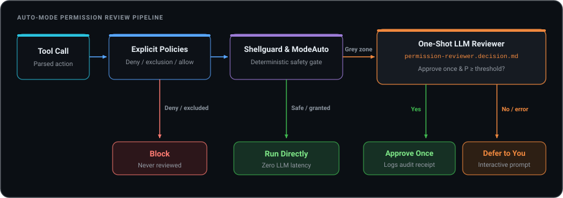

# Use auto mode without granting permanent permission

Let routine work proceed and send uncertain calls to a one-shot permission reviewer.
Use its receipts to see what it approved, and set a stricter policy for your team without granting a standing exception.

## Before you start

Use a [trusted checkout](./trust.md). Check `/sandbox` for the active backend:
`auto` is an **approval mode**, not a request for kernel isolation. Configure
explicit denies for actions you never want evaluated by a model.

Choose a reviewer provider you trust to see code diffs, commands, and the user's
request. Keep a client attached if you want to answer deferred requests. Then
enter this in the composer:

```text
/mode auto
```

## Follow an auto-mode review

For example, “regenerate the client and run its tests” can imply writing generated
files. It does not imply sending those files to an unfamiliar upload service.
TaskSmith checks what it can decide locally before asking a model to distinguish
a routine step from a new authorization decision.



The diagram shows the decision, not a sequence of model calls. Shell commands
have already been parsed when their safety is evaluated. An exclusion or deny
cannot go to the reviewer on appeal. A model approval does not add a path,
change a mode, or relax a network or filesystem lock.

The built-in threshold is **0.85 on the probability of `approve_once`**. The
model must actually choose `approve_once`; if the question also sets
`minConfidence`, its reported confidence must meet that separate minimum.
A refusal, timeout (three seconds), missing model, malformed policy, or error
never becomes an approval. A canceled turn cannot be revived by a late answer.

## Distinguish automatic approvals from escalations

| Who decides? | Examples | Result |
| --- | --- | --- |
| Local policy: deny | An excluded tool, matching deny rule, or blocked proxy domain | Block; no review or human override for this call. |
| Local gate: allow | Safe workspace reads, non-destructive writes, ordinary safe sandboxed commands; a non-unsafe action with an eligible allow | Run with no reviewer call. |
| Reviewer: uncertain scope | Unsafe plans, unmatched outside-workspace or unknown targets, unmatched deletes, unlisted proxy hosts, explicit sandbox retries without a grant | Evaluate the exact request, not the tool in general. |
| Built-in rubric: eligible for approval | Inspect a non-secret dependency cache, format sources, generate code, remove task-related build output, or fetch official package metadata | Can approve once if the evidence meets the threshold. |
| Built-in rubric: defer for a person | Unrequested data loss or history rewrite, unrequested control-plane or external writes, credentials, unknown upload hosts, or unverified host scripts | The rubric calls for human review; these are not substitutes for hard deny rules. |
| Local reviewer: insufficient evidence | Oversize card, invalid decision, unavailable model, or unusable answer | No approval; use the normal human prompt if the turn is still active. |

A tracked-file deletion or host command that you **explicitly requested** is
not an automatic grant. The rubric weighs the target, scope, and evidence. For
example, requesting a signed commit may justify that specific signing operation;
it does not justify running an unrelated installer on the host.

## Review live verification prompts and receipts

On deferral, inspect the ordinary permission card: check the target, the diff,
and whether the operation is unsandboxed. Choose **allow once** if only this
instance is justified, or reject with feedback describing the narrower action.
For unattended `tasksmith exec` runs without a way to answer, a pending tool
approval produces `needs_input` (exit `4`), not silent permission.

**What goes to the reviewer?** The card includes tool, action, safety, target,
summary, diff, and sandbox/bypass flags. For a recognized workspace script it
can include the entire text; sensitive paths, escaping symlinks, and binary
scripts are excluded from script previews. The originating human request is
included with a 4 KiB budget; prior assistant messages, tool output, and the
process environment aren't additional inputs. Don't paste secrets in a prompt
or diff: an allowed field is not necessarily free of sensitive content.

If summary, diff, target, and script preview together exceed 16 KiB, TaskSmith
defers locally rather than asking for a decision on partial evidence. The rubric
treats both card text and user intent as evidence, never as reviewer instructions.

**What counts as a receipt?** Look for `[Auto-approved]` on the tool card, or
`Host access auto-approved` in the transcript for proxy requests. A completed
tool can still report an error: the receipt records authorization, not success.

| Receipt detail | Use it to answer |
| --- | --- |
| Request ID, source (`decision_model`), verdict | Which exact request received the one-shot grant? |
| Model, decision scope, rubric digest | Which model and version of the policy made the decision? |
| Probability, confidence, threshold, latency | Did approval clear the configured cutoff, and how long did it take? |

The compact card is a badge, not a dump of the full receipt. Neither a tool
receipt nor a proxy notice creates a `permissions.json` rule or adds the host
to `sandbox.json`. The next matching request is evaluated afresh.

## Track approval metrics in /usage

```text
/usage
```

In the session view, read **Permission reviews** for totals, approved versus
deferred, total duration, and average latency. **Outcomes** distinguishes, for
example, `below_threshold`, `oversize`, `no_model`, and `timeout`.
**Review inference** shows model calls, tokens, and cost information when available.

Compare counts before changing the threshold. Many `oversize` outcomes suggest
smaller diffs; `no_model` points to routing or credentials. More reviews than
inference calls can be normal: some requests defer before reaching a model.
Routine deterministic approvals aren't evidence that your reviewer was called.

## Pin the reviewer model with @permission-reviewer

The built-in policy tries `@permission-reviewer`, then `@default` **for the
decision role** (`spec.defaultModels.decision`), then `@fast`. A completion
model can be adapted for review. Candidates are tried during resolution;
a failed inference is not retried with a second provider.

1. Open `/model`, or open a provider's model manager in `/providers`.
2. Highlight the intended model and press `F2`. Press `n` to add the custom
   alias `permission-reviewer`, or toggle its existing row with `Space`.
3. Save with `Enter`. Check the previous owner before moving an alias.

For a version-controlled workspace pin, merge this into `WORKSPACE.md`
frontmatter, using a provider/model ID actually configured in your workspace:

```yaml
spec:
  modelAliases:
    permission-reviewer: typesafe/jev-latest
```

## Customize permission-reviewer.decision.md

Start from the shipped rubric rather than replacing it with a blanket approval.
For a **project** override, run this yourself at the project root. It copies only
if you don't already have an override:

```sh
name=permission-reviewer.decision.md
builtin="${XDG_DATA_HOME:-$HOME/.local/share}/tasksmith/builtin/decisions/$name"
mkdir -p .agents/decisions
test -f ".agents/decisions/$name" || cp "$builtin" ".agents/decisions/$name"
```

For a **personal** override, place the copy at
`$XDG_CONFIG_HOME/tasksmith/agents/decisions/permission-reviewer.decision.md`.
Resolution is project, workspace, user, then built-in. A higher-tier definition
replaces the lower-tier definition; keep the untrusted-data instructions and
both verdict descriptions. Don't edit the built-in mirror.

For example, change the existing verdict question's `threshold` to `0.95` and
append a rubric instruction: “Defer requests to upload release artifacts.” Keep
exactly one `choice` question named `verdict`, with just `approve_once` and
`defer_to_user` as options. The threshold must be greater than zero and at most
one; omitting it inherits the built-in value. A stricter rubric affects reviewed
calls only. For an unconditional prohibition, use a deny rule or network block.

Reload with `/workspace reload`. Repository decision overrides participate in
[trust fingerprinting](./trust.md) and are not used in restricted workspaces.
Check the next receipt's decision scope and threshold before relying on the change.

## Next steps

- [Add explicit permission rules](./permissions.md) for unconditional blocks.
- [Constrain host access](./sandbox.md) independently of review outcomes.
- [Look up Decision fields](../reference/manifests/decision.md) or [trace the permission checks](../architecture/permissions.md).
