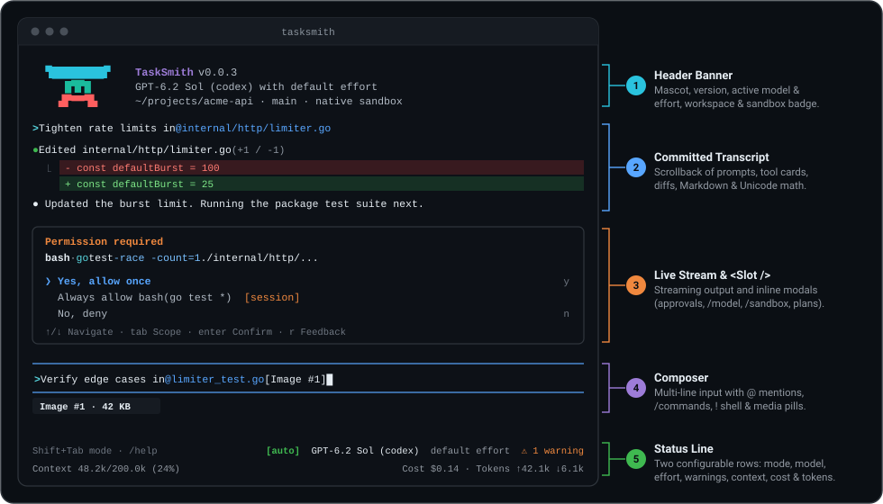

# Work in the interactive terminal

Use the composer to give TaskSmith the right files, inspect each tool call as it runs,
and answer approvals or questions without leaving your conversation.

## Start an interactive session

Run this from the directory you want to work in:

```bash
tasksmith
```

Or choose the directory from elsewhere:

```bash
tasksmith -w ~/projects/backend-api
```

The CLI connects to the local daemon, starting it if needed. Check the workspace and
model in the banner before sending a prompt. Press `Enter` to send; `Shift+Enter` or
`Alt+Enter` inserts a newline. Type `/` for command and skill suggestions, including
built-ins. Filter by typing; arrows or `Ctrl+P`/`Ctrl+N` move, and `Tab` inserts.
Use `/help` to browse commands without submitting one.

<a id="headless-execution--ci"></a>

If you want an answer on stdout instead of the terminal UI, use the
[headless execution and CI guide](./headless-exec.md).

## Terminal layout



| Region | What to look for |
| --- | --- |
| **Header banner** | Version, resolved model and thinking effort, and workspace (`~` abbreviates home). The workspace path is followed by the current Git branch (or `HEAD@` and a short commit ID when detached) and the sandbox mode, when available. The live mascot moves while idle and rests on input; scrollback stays still. |
| **Committed transcript** | Previous prompts, replies, tool results, and colored edit/write diffs. Earlier output isn't rewritten by later health changes. |
| **Live stream and slot** | The current response, thinking indicator, or inline view waiting for your choice. Tool cards show the action, target, status, timing, and available byte/line counts. |
| **Composer** | Your draft, attachment pills, and autocomplete. Type a prompt, `/command`, or `!` followed by a shell command. |
| **Status line** | Shortcuts, permission mode, model/provider, effort, and active warnings on top; context, cost (or quota), and tokens below. |

<a id="4-status-line"></a>

### Follow warnings and activity

A pulsing dot means a tool is working; green or red marks success or failure. Extended
reasoning appears as **Thinking** and collapses to **Thought** once generation begins.
Errors and operation-specific warnings stay inline. Explicit MCP actions report results;
background MCP refreshes update the warning count rather than printing announcements.

Use `/warnings` or click the count in a mouse-capable terminal when no other view is open.
Select with arrows, `k`/`j`, or `Ctrl+P`/`Ctrl+N`; `Enter` opens details and a suggested
fix when available. `Esc` goes back. Resolved warnings drop out; zero warnings hides the count.

Use `/statusline` for a live preview: arrows select and reorder, `Space` toggles, `r` moves
an enabled segment between rows, `c` selects shorter text, `s` saves, and `Esc` discards.
Empty rows disappear. Direct edits to `~/.config/tasksmith/statusline.json` take effect on restart.
Use `/theme` for colors. The [appearance guide](./appearance.md) covers both.

Your terminal tab uses the session title (workspace name until one exists), without a brand
prefix. Supporting terminals show progress while working, paused on interaction, and errors
via OSC 9;4. Program Status (OSC 7501) distinguishes working, blocked (permission, question,
or auth), done, error, and idle. Unsupported sequences are not sent; exit clears terminal status.

## Compose prompts with `@` mentions and media

Type `@` and start a filename. The fuzzy picker ranks recent reads and changes first.
Selecting an entry inserts its shortest unique workspace suffix, quoted if it contains spaces.
Choose a directory for a listing or a line range for a focused question:

```text
Explain @README.md#L10-L20 and compare it with the examples in @docs/.
```

`@file:<path>` also works, and `#L42` selects one line. The picker marks prohibited paths;
a mention can't grant access outside workspace policy. A filename in ordinary pasted log text
isn't the same as an attachment.

| To attach… | Use… |
| --- | --- |
| An instruction or workflow | `@rule:` or `@skill:` and choose a name. Invoke a skill with arguments through `/` instead. |
| An MCP resource | `@mcp:` and select the resource from a configured server. |
| A screenshot or PDF | Mention a PNG, JPEG, WebP, GIF, or PDF by path. SVG stays text. |
| Audio | Mention a WAV, MP3, M4A, OGG, or FLAC file and ask what you need from it. |

For a clipboard image, press `Ctrl+V` or `Alt+V`. A staged `[Image #1]` pill in the draft
means it will be attached on send; delete the token to detach it. Supported media is snapshotted
under `<session-dir>/media/<sha256>`, so the attachment is tied to the session's copy.

If the model can't accept that modality, TaskSmith omits the media with a notice. If you
switch models while an earlier attachment is still in context, choose **Cancel** to keep
using it or **Switch anyway** to omit incompatible historical media on future turns.

### Recall a draft or stop a turn

At the beginning or end of your input, `Up` or `Down` browses previous prompts. The border
shows your position, such as `history (3/42)`, and completion stays closed. `Esc` restores
the draft you were typing; type into a recalled entry to keep it. History persists across
sessions in `~/.local/state/tasksmith/history/repl.jsonl`.

During streaming, `Esc` cancels the active turn, including a user-invoked delegated command.
Autonomous subagents and background tasks continue: stop them via `/subagents` or `/tasks`.
`Ctrl+C` once clears input; twice within two seconds exits, as do `/exit`, `/quit`, and `/q`.

## Run quick shell commands with `!`

Type `!` as the first character on an empty composer line. The prompt changes to `! `;
enter your command and press `Enter`, or press `Esc` to leave shell mode before submitting.
For example, in a Git checkout:

```text
!git status --short
```

This is **your command**, not a request for the model to choose one. It runs through the
daemon. In a trusted workspace with `allowUnsandboxed` enabled it runs on the host;
in Restricted Mode that setting is forced off and the repository is read-only.

## Navigate inline pickers (`<Slot />`)

When TaskSmith needs a decision, its inline view opens above the status line. Use arrows
or `Ctrl+P`/`Ctrl+N` to move, `PgUp`/`PgDn` or `Ctrl+B`/`Ctrl+F` to page, and `Enter`
to choose. Some views also accept `k`/`j`.

### Respond to an approval, question, or plan

- **Permission:** inspect the target and any diff before choosing. `y` allows once;
  `a` grants the displayed pattern. `Tab` cycles session, project, and global scope.
  `n` denies; `r` lets you explain why so the agent can take a different approach.
- **Question:** choose an option or **Custom answer**. For multi-select, `Space` toggles
  and `Enter` confirms; confirmations offer Yes/No. In multi-step forms, `Left` or
  `Shift+Tab` goes back, `Right` moves forward, and `Esc` cancels. If `ask_question`
  itself needs permission, the form appears only after that call is allowed.
- **Plan:** inspect the path and line count; `p` opens the rendered plan. `p` or `Esc`
  returns to the choices. Approve in `accept_edits`, `default`, or `auto`, or choose
  **Keep planning** (`4`/`r`) and request a revision.

### Select a model or inspect policy

| Open | What you can do |
| --- | --- |
| `/model` | Filter chat-capable models; switch by ID or `@alias`. `F2` edits persistent aliases rather than switching the session. |
| `/providers` | Check provider health, sign in, enable/disable a provider, or manage its models and aliases. |
| `/permissions` | Inspect project/global allow and deny rules. Read the pattern and scope before saving. |
| `/sandbox` | Inspect kernel health and trust, adjust isolation, and compare scope overrides with effective policy. |

In `/sandbox`, use `1`–`3`, horizontal arrows, or `Tab`/`Shift+Tab` to change tabs.
**Policy** shows the session backend and host remediation if needed (such as an AppArmor
restriction). `Space`/`Enter`/`t` cycles mode or toggles a knob; `x`/`Backspace` clears
an override. Locked settings identify the other scope or trust floor that pins them.
**Exclusions** lets you add (`a`), edit (`e`), or delete (`d`) command patterns; inherited
global entries are read-only in Project scope. **Effective** shows merged network posture,
domains, command exclusions, and path rules. `s` switches Project/Global on editable tabs.
Edits save immediately; changing the backend requires a new session. See [sandbox settings](./sandbox.md).

`/agent` switches personas. `/effort`, `/budget`, and `/thinking` offer only controls the
model supports (toggle `on`/`off` or `adaptive` as appropriate). Unsupported commands explain
why. Each change replaces the previous thinking override; `default` restores the agent/model
default, or `provider default` if neither declares one. The banner calls the latter `default effort`.

`/tools`, `/rules`, and `/mcp` inspect availability and reload resources. For sessions,
changes, tasks, subagents, usage, and speed, follow the [session guide](./sessions.md).

<a id="code-reviews"></a>

### Request a review

`/review` inspects staged and unstaged changes. Name a target for a branch, commit range,
or PR: `/review feature-branch`, `/review HEAD~1..HEAD`, or `/review PR 42`. The clean,
read-only `code-reviewer` reports verified findings with line citations. It doesn't edit files
or post PR comments; remote PRs need network access and private ones an authorized `gh`.

Reviews try `@code-reviewer`, `@smart`, `@inherit`, then `*`. To assign a review model,
highlight it in `/model`, press `F2`, then `n`, type `code-reviewer`, confirm with `Enter`,
and press `Enter` again to save. Workspace `spec.modelAliases` can override this.

<a id="design-interviews-grill-me"></a>

For a design interview instead of a code review, try `/grill-me Should task retries be automatic?`.
It asks questions without writing files. [Move from design to a plan](./modes-and-planning.md)
when the decisions are settled.

## Readable output

Replies render GitHub-flavored Markdown: lists, emphasis, highlighted code blocks, and tables.
Ask for a table when comparing alternatives. Inline math such as `$P \ge 0.95$` displays
as copyable Unicode (`P ≥ 0.95`); `\(...\)` works too. Place `$$...$$` or `\[...\]` on a
separate line for an indented formula. Put TeX in backticks or a code fence to show it literally.

Shell commands are highlighted from their parsed syntax (AST), making command names and
arguments easier to distinguish. During a terminal resize, redraws are debounced so the
live view settles at the new width instead of repainting on every intermediate size.

## Next steps

- [Resume a session and inspect changes](./sessions.md).
- [Switch modes and review a plan](./modes-and-planning.md).
- [Customize the status line and theme](./appearance.md).
- Look up [slash commands](../reference/cli/slash-commands.md) and [keyboard shortcuts](../reference/cli/keybindings.md).
