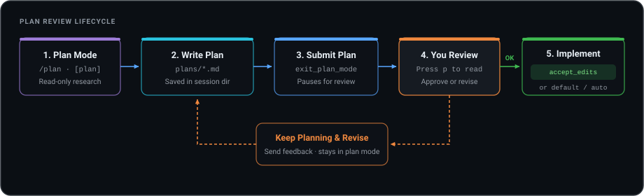

# Choose a session mode and review a plan

Decide whether TaskSmith should answer a question, draft a plan, or change files.
Use plan review to agree on an approach before choosing how its implementation will be approved.

## Compare the five modes

A mode controls two different things: what you ask the agent to **do** and when a tool
call needs **approval**. `ask` and `plan` change the first without granting broad new permissions.

| Mode | Safe workspace reads | File changes | Shell and review |
| --- | --- | --- | --- |
| `default` | Run directly | Normally prompt | Safe read-only commands run; mutating commands normally prompt. |
| `accept_edits` | Run directly | Safe writes and edits run; removals prompt | Same shell and network gates as `default`. |
| `plan` | Investigate | Write the plan in session storage; workspace writes use normal gates | Default gates; submit the finished plan for your review. |
| `ask` | Investigate to answer | Agent answers without modifying files | Default gates, not a request to approve every read. |
| `auto` | Run directly | Safe non-destructive workspace operations run | Riskier calls go to an automated reviewer; it can defer to you. |

These are baselines, not overrides for explicit deny rules, tool exclusions, trust,
or sandbox policy. For example, a normal workspace search and a read outside the
workspace need not receive the same decision.

**Pick a starting point:**

- “Where is the config loaded?” → `ask`.
- “How should we migrate this config format?” → `plan`.
- “Implement this agreed migration, but ask before running commands” → `accept_edits`
  if the usual shell rules give you the review you need.
- “Let me check each proposed write” → `default`, subject to your existing rules.

## Switch modes mid-session

With the composer empty, press `Shift+Tab` to cycle through the modes:

```text
default → accept_edits → plan → ask → auto → default
```

Or open `/mode` and choose by name. To go straight to a known mode:

```text
/mode ask
```

The new setting affects this session; it doesn't write a general permission rule.
To set the starting mode for a one-shot run, pass it explicitly:

```bash
tasksmith exec --mode ask "Explain how configuration is loaded."
```

### Check what happens to waiting requests

When you widen the mode, TaskSmith rechecks pending approvals in this session **and
its active subagents**. A pending request newly allowed by the mode can be approved
once if it isn't classified as unsafe. Nothing is automatically rejected, and no
persistent rule is created. Explicit sandbox-bypass retries and unlisted proxy hosts
still need approval.

If the main session pauses on an eligible write, press `e` for **Yes, and switch to
accept_edits**. That grants the current request and changes the mode, not the rulebook.
This choice isn't offered for unsafe operations, sandbox-bypass retries, subagent
prompts, or sessions already in `accept_edits` or `auto`.

## Plan before editing with `/plan`

Use `/plan` without an argument to switch modes before composing the task.
To switch **and** submit the prompt in one step:

```text
/plan Add an optional timeout to the API client. Keep existing callers compatible.
```

In a top-level session, the agent can also request planning with `enter_plan_mode`.
It investigates relevant files, asks clarifying questions, and drafts a plan rather
than implementing the change. Decide where you want the plan kept:

| Location | When to use it |
| --- | --- |
| `<session-dir>/plans/` | A private session draft. Plan writes, edits, and removals here don't prompt, even in Restricted Mode. |
| Inside the workspace | A document you want to share or version with the code. Normal workspace permissions and trust apply. |

Tell the agent if you want the session directory, for example:

```text
Keep the plan with this session. Include how we'll test a timeout without sleeping in the test.
```

Once the plan exists, the agent calls `exit_plan_mode` with its path. The turn pauses
for your decision; writing the file does **not** approve the plan.

### Settle design questions before asking for a plan

If the task itself is still ambiguous, start a design interview:

```text
/grill-me Should we retry a timed-out notification?
```

Without a topic, the agent uses the current conversation if the subject is clear,
or asks what to explore. It checks relevant code and docs for project questions;
for an unrelated idea it starts with the idea, not a workspace scan.

For example, if a timeout can happen *after* an email was sent, first decide whether
a duplicate or a missed message is worse. Your answer determines which failures
should be retried, before you decide how many retries to allow.

The recommended option comes first with a reason. You can supply a custom answer,
narrow the scope, or say you don't know. Rounds group up to five independent questions;
ask for one at a time if you prefer. Leave prototype-dependent decisions open and
note what evidence would settle them.

Stop when you have enough information. Check the summary of decisions, reasons,
and open questions; correct it or confirm it. The interview itself doesn't write
files, implement the design, or switch modes. Run `/plan` as a separate next step.
In [headless runs](./headless-exec.md), use bidirectional input to answer questions.

## How the plan review flow works



The inline review shows the file path and line count. Press `p` to read the full
rendered Markdown plan; scroll through it and press `p` or `Esc` to return to the
choices. Leaving the **viewer** is not the same as canceling the **review**.

1. **Approve & auto-accept edits** switches to `accept_edits`.
2. **Approve with standard prompts** switches to `default`.
3. **Approve autonomous** switches to `auto`.
4. **Keep planning** leaves the session in `plan`. Press `4` or `r` to give feedback;
   canceling the review with `Esc` also leaves you in `plan`.

Useful revision feedback names the missing decision or evidence, for example:

```text
Keep the migration opt-in. Add a rollback step and name the compatibility test before implementing.
```

## Choose between `accept_edits` and `auto`

Choose **`accept_edits`** when you trust routine file operations but want shell and
network actions to follow the usual approval rules. This is often enough after you
have reviewed a small change with a clear file scope.

Choose **`auto`** when the task requires a mix of operations and you want the
permission reviewer to evaluate higher-risk calls. Unsafe operations, unmatched deletes
or outside-workspace operations, bypass retries, and unlisted proxy hosts are not
blanket-approved. The reviewer can allow, deny, or defer; explicit policy denials still block.

If you need a lasting exception for a *specific* action, configure a narrowly scoped
rule instead of widening the entire session. If you'd rather review the next action
yourself, switch back with `/mode default` and inspect any existing allow rules.

## Next steps

- [Configure narrowly scoped permissions](./permissions.md).
- [Understand automated permission review](./auto-permission-review.md).
- [Look up planning tools and decisions](../reference/tools/agents-and-planning.md).
