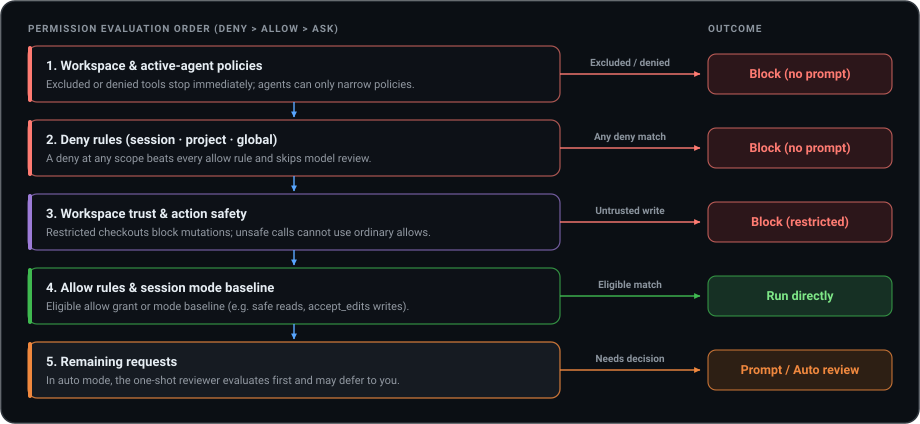

# Control which tool calls need approval

Let routine work run without interruption, stop unwanted actions outright, and
choose when TaskSmith should ask. Keep personal grants separate from policies
you want everyone in a repository to inherit.

## Understand how permission evaluation works

Start with **deny > allow > ask**, not “the most specific rule wins.” A project
allow does not cancel a global deny. The decision applies to a planned action,
including its tool, target, safety classification, and sandbox posture.



| Check | What it means for you |
| --- | --- |
| Workspace and active-agent policies | An excluded or denied tool cannot be approved. An agent may narrow the workspace policy, never widen it. |
| Session, project, and global deny rules | A match at **any** scope blocks the call without a prompt or model review. |
| Trust and safety | Restricted workspaces block mutations. Safe mutations in the session's own plans directory are a special case after denials. |
| Allow rules and session mode | An eligible matching grant or the mode's safe baseline runs the call. An ordinary allow cannot clear an unsafe classification. |
| Remaining requests | TaskSmith asks. In `auto`, the one-shot reviewer can resolve a request before you see it. |

For example, in `default` a safe read normally runs; an ordinary file edit
normally prompts. A workspace `ask` on a read-only tool can still trigger an
approval. Under `auto`, a policy `ask` does not unconditionally force a human
prompt; use a deny or exclusion for a boundary that must never be crossed.

To inspect or change the current mode, enter:

```text
/mode
```

`Shift+Tab` cycles modes from the composer. Compare the five modes, including
planning and question-answering behavior, in [Modes and planning](./modes-and-planning.md).

## Respond to interactive approval prompts

Read the tool name and target first. For `bash`, read the **whole command**, not
just its first executable. For `edit` and `write`, inspect the diff when supplied.
An `UNSANDBOXED` warning means the kernel wrapper will not protect that command.

| To do this | Choose this in the prompt |
| --- | --- |
| Allow once | **Yes, allow once** (`y`); no future grant. |
| Allow for this session | Select an **Always allow** pattern and choose `[session]` with `Tab`. |
| Allow in this project | Select the narrow pattern, then `Tab` to `[project]` before confirming. |
| Allow across projects | Choose `[global]` only if the rule makes sense for every workspace you use. |
| Reject this call | **No, deny** (`n`), or press `r` to reject with feedback explaining what to do instead. |
| Always reject matching calls | Reject now, then add a **deny** in `/permissions`. There is no persistent-reject row in the prompt. |
| Approve this write and change mode | **Yes, and switch to accept_edits** (`e`) when offered. No rule is created. |

Use the arrows and `Enter` to confirm the highlighted choice. Compare suggested
patterns: `bash(go test *)` is narrower than `bash(go *)`. If neither pattern is
appropriate, allow once instead of granting all invocations of a tool.

The mode-switch row is for eligible main-session writes, not unsafe actions,
sandbox-bypass retries, or subagent prompts. It isn't offered in `auto` or when
already accepting edits. Widening a mode rechecks outstanding approvals in the
session and its subagents: other eligible calls may receive a one-time approval.
Pending unsafe calls, explicit bypasses, and unlisted hosts still need a decision.
Tightening a mode doesn't reject the requests already waiting.

## Write rule patterns

Use `tool(pattern)`: both parts must be nonempty and parentheses cannot be nested.
Match the **target on the card**. For a filesystem tool this may be a resolved
absolute path rather than the relative argument the agent originally supplied.
The prompt's exact-path suggestion avoids guessing the target.

| Pattern | Matches |
| --- | --- |
| `bash(git status *)` | `git status` itself and command strings beginning with `git status ` |
| `bash(go test *)` | Go test invocations; `bash(npm test *)` and `bash(cargo check *)` work the same way |
| `edit(internal/server/*.go)` | Go files directly in `internal/server` **on a relative target** |
| `write(src/**)` | The relative `src` target itself or its descendants |
| `view(**/CHANGELOG.md)` | A changelog by suffix, including on absolute targets |
| `net(registry.npmjs.org)` | An unlisted proxy host, not every network tool |
| `web_fetch(api.github.com)` | Fetches targeting this host; you may also match a complete URL |
| `web_search(*)` | Any search query; queries aren't URLs |
| `notes__echo(*)` | One discovered MCP tool, named `<server>__<tool>`; not every tool on `notes` |
| `bash_unsandboxed(git commit *)` | An explicit unsandboxed commit retry, not an ordinary sandboxed commit |

`*` is a wildcard, `?` matches one non-slash character, and `**` can span
subdirectories. `write(*.md)` matches a single relative path component. A
trailing ` *` on a command is a string prefix, not an argument policy: it does
not certify that all following arguments, redirects, or piped commands are safe.
TaskSmith inspects shell structure separately.

The tool name can also be a wildcard: `*(src/**)` matches any tool with that
relative target. Avoid granting `*(*)`: it covers all tools and targets,
including explicit sandbox-bypass plans. Prefer the exact tool and target.

A plain `bash(git *)` **deny** also covers unsandboxed Git. In contrast, a
`bash_unsandboxed(git *)` deny targets only unsandboxed Git, including excluded
commands. A plain `bash(...)` **allow** does not approve explicit bypass retries.

## Manage rules interactively with /permissions

1. Enter `/permissions` (aliases: `/perm`, `/perms`).
2. Choose **Project** or **Global**, then press `Enter`.
3. Switch between the allowlist and denylist with `Tab` or the arrow keys.
4. Press `a`, type one pattern, and submit with `Enter`. For example, add
   `notes__echo(*)` to the denylist to prevent that tool from running.
5. Highlight a rule and press `e` to edit, or `d`, `Backspace`, or `Delete`
   to remove it. `Esc` backs out of the current step.

If an allowed operation is still blocked, inspect the denylist in **both**
scopes. Removing one copy doesn't remove the same rule from another scope.
Session grants are specific to the session, not a third persistent editor tab.

## Configure permissions.json

Use the editor above, or edit the appropriate file yourself. Project rules are
local to your workstation, not checked into the repository.

| Scope | Location | Applies to |
| --- | --- | --- |
| Global | `$XDG_CONFIG_HOME/tasksmith/permissions.json` | All your workspaces; normally `~/.config/tasksmith/permissions.json` |
| Project | `$XDG_DATA_HOME/tasksmith/workspaces/<hash>/permissions.json` | This workspace root; the data home defaults to `~/.local/share` |
| Session | Session grant, not either of these files | This session and its active subagents |

For example, start new sessions in `default`, permit Go tests, and block force
pushes matching this command prefix:

```json
{
  "schema": 1,
  "defaultMode": "default",
  "allow": ["bash(go test *)"],
  "deny": ["bash(git push --force *)"]
}
```

This deny matches that spelling, not all Git equivalents or actions by other
tools. The rule lists combine across scopes. `defaultMode` instead takes the
project setting if present, otherwise the global setting. Changing the current
session mode does not rewrite either file.

There is **no `ask` array** in this file. Use the workspace policy below for a
persistent request to ask. Legacy `disabledTools` and `disabledMcps` keys have
no effect. Use `/tools` (`Space`) or `/mcp` (`e` or `Space`) for availability:
a resource's `spec.enabled: false` or a workspace exclusion removes it from the
agent's available tools, rather than waiting to reject a call.

Policy files are not agent-editable preferences. Writes targeting TaskSmith's
stores are treated as sensitive, and the native sandbox protects the config and
data directories from writes by subprocesses. Use the human-facing editor;
do not ask the agent to edit the rule that is stopping it.

## Set declarative workspace policies in WORKSPACE.md

Put a team baseline in the manifest's frontmatter. This example asks about
shell calls outside `auto` unless explicitly allowed, and excludes `download`
regardless of mode. It does not grant permission to any shell command:

```yaml
---
apiVersion: warp/v1alpha1
kind: Workspace
metadata:
  name: backend-service
spec:
  policies:
    tools:
      ask: [bash, edit, write]
      exclude: [download]
      dangerous: ask
      openWorld: ask
---
```

`include` is an allowlist of **eligible tools**, not an approval rule: setting
`include: [view, grep, glob]` excludes other tools from that policy. `include`,
`exclude`, and `ask` accept short names and namespace-qualified name patterns
(`namespace/name` or `namespace/Kind/name`). An `ask` can name `ask_question` too.

`dangerous` and `openWorld` apply to tool annotations and accept `allow`, `ask`,
or `deny`; their defaults are `ask` and `allow`, respectively. `readOnly: true`
limits the policy to read-only tools. The stricter workspace or active-agent
policy wins. With the native backend, read-only workspace/agent policy also
makes the workspace read-only to child processes regardless of permission mode.

## Next steps

- [Use one-shot automatic review](./auto-permission-review.md) instead of adding a broad grant.
- [Control subprocess and network isolation](./sandbox.md) after a tool is approved.
- [Inspect permission evaluation](../architecture/permissions.md) or [look up workspace policy fields](../reference/manifests/workspace.md).
