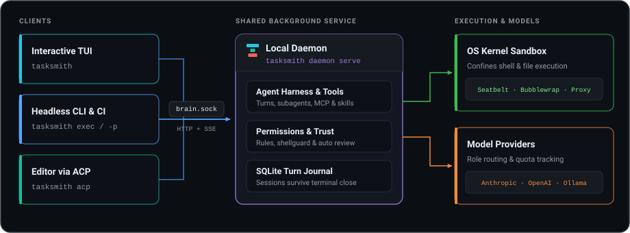

# Start your first TaskSmith session

Install TaskSmith, connect one model, and ask a question about a project you know.
You don't need to write a configuration file or start a server yourself.

## Before you start

- Use a terminal on macOS or Linux.
- Pick a local project you recognize. A directory with a `README.md` is enough for the examples below.
- Have a provider account, an API key, or a running local model endpoint ready.
- You only need Go if you choose the source installation below.

## Install TaskSmith

Choose **one** installation method.

**Homebrew** on macOS or Linux:

```bash
brew tap masterkeysrd/tasksmith https://github.com/masterkeysrd/tasksmith
brew install masterkeysrd/tasksmith/tasksmith
```

**Release binary** without Homebrew: the shell installer downloads the prebuilt binary,
verifies its SHA-256 checksum, and installs it in `~/.local/bin`.

```bash
curl -fsSL https://github.com/masterkeysrd/tasksmith/releases/latest/download/install.sh | sh
```

If your shell doesn't search that directory, add it for this terminal:

```bash
export PATH="$HOME/.local/bin:$PATH"
```

**From source** with Go 1.26 or later:

```bash
go install github.com/masterkeysrd/tasksmith/cmd/tasksmith@latest
```

Make sure your Go binary directory is on `PATH`. Check which executable this terminal will use:

```bash
command -v tasksmith
tasksmith version
```

## Connect a model provider

Choose the row that matches how you normally access a model:

| If you use… | Do this |
| --- | --- |
| A browser subscription supported by an OAuth preset | Select that preset in setup, then sign in through TaskSmith. |
| A metered API | Select its preset and supply the key through the wizard or the provider's environment variable. |
| A local model | Select the local preset (such as Ollama) and verify its endpoint and model are available. |

If your OAuth provider is **already configured**, sign in from the terminal in your project:

```bash
tasksmith auth login
tasksmith auth status
```

Name the provider if more than one is configured. Antigravity supports `--paste` if the
browser cannot reach the callback; Codex, Claude Code, and GitHub Copilot require a browser
on the daemon host. You can also sign in with `/login` in the interactive session.

For an API key, the name must match the configured provider; for example, an Anthropic
preset can read `ANTHROPIC_API_KEY`. To enter it in Bash without putting the value in history,
before starting the daemon:

```bash
read -rsp 'Anthropic API key: ' ANTHROPIC_API_KEY; printf '\n'
export ANTHROPIC_API_KEY
```

If the daemon is already running, use setup to save the key in the appropriate `.env`
instead of relying on later changes to a different shell's environment.
Never put a real key in `WORKSPACE.md`, a prompt, or a tracked file.

## Start your first session

From the project directory, run:

```bash
tasksmith
```

You can also select an existing directory without changing shells:

```bash
tasksmith --workspace "$HOME/projects/my-app"
```

1. **Decide whether to trust the directory.** Trust a known folder to use its local
   configuration. For an unfamiliar checkout, use Restricted Mode or exit and inspect
   it first. Only trust a parent folder if you mean to trust its descendants.
2. **Choose a provider in setup** if the workspace isn't configured. Reuse global
   providers or choose a preset. User scope keeps personal settings out of the repo;
   workspace scope shares configuration, not secret values. Project overrides belong
   to the selected subproject.
3. **Verify credentials, then review what will be written.** Setup lets you choose
   a permission mode and exclude tools or MCP servers. It offers `/init` if there is
   no `AGENTS.md`. A configured workspace can go straight to the session or prompt
   for missing credentials instead.
4. **Send a question.** At the composer, type the following and press `Enter`:

```text
What does this project do, and where should I look first? Don't change any files.
```

Look for a reply in the transcript. The banner shows the resolved model and workspace;
`/model` lists available chat models. To revisit first-run choices later, run `/setup`.

To add another provider, open `/providers`, press `a`, and select a preset or custom
provider. Open its model list with `Enter`; use `l` to sign in to an OAuth provider.
Adding a preset preserves existing model aliases. Both models remain selectable by full ID.

## How TaskSmith runs



The clients share one local daemon. It connects to providers, runs tools, and keeps
the session journal. The CLI connects on `$XDG_RUNTIME_DIR/tasksmith/brain.sock`
and starts a detached `tasksmith daemon serve` when needed. Closing the terminal UI
doesn't discard your session or stop background tasks managed by the daemon.

## Try common workflows

Enter these **in the composer**, one at a time:

| To… | Try |
| --- | --- |
| Ask about a specific file | `Summarize @README.md in two sentences.` |
| See a proposal before edits | `/plan Improve the getting-started example in the README.` |
| Review local staged and unstaged changes | `/review` |
| Run your own shell command | `!git status --short` |

Review is read-only: it reports verified findings with line citations rather than
editing files or posting PR comments. Try `/review HEAD~1..HEAD` to review the last commit.

Exit with `/exit`. Next time, run `tasksmith -c` in the same workspace to continue.

## Next steps

- [Navigate the interactive terminal](./cli.md) and attach files or media.
- [Configure your workspace](./workspaces.md) for a team or monorepo.
- [Choose a session mode and review a plan](./modes-and-planning.md).
- [Look up provider settings](../reference/providers.md) for your connection.
