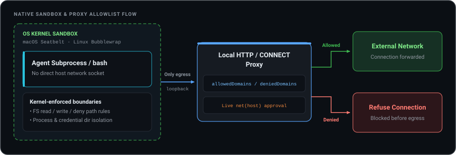

# Confine commands, files, and network access

Choose a sandbox backend, constrain where commands can write, and approve network hosts without giving a subprocess unrestricted connectivity. Use permissions to decide **whether a call may run** and the sandbox to limit **what it can do when it runs**. Run `/sandbox` at any time to check your workspace's trust status, active backend, and host health.

## Compare native and local sandboxing

| Backend | What protects file and network tools? | What protects child processes? |
| --- | --- | --- |
| `native` on macOS | Root-confined file tools and policy-aware network tools | Seatbelt kernel profile |
| `native` on Linux | Same | Bubblewrap (`bwrap`) with usable kernel namespaces |
| `local` | Same in-process checks | Host process groups and a working directory; **no kernel filesystem or network confinement for arbitrary commands** |

Start a new session from your shell:

```sh
tasksmith --sandbox native
```

`tasksmith --sandbox local` explicitly requests the local backend. By default
TaskSmith prefers native if the host probe can actually launch a sandbox. Even
an explicit native request can fall back to local with a warning unless you
set `failIfUnavailable: true`. If kernel confinement is required, set that
lock, request native, and check the backend shown in the session header.

A backend is fixed when a session is created. Resuming an old session does not
upgrade it; start a new session after changing the default. Subagents inherit
their parent's effective backend.

## Trace how sandbox isolation works

This is the path for a **native subprocess in allowlist mode**. Open networking,
fully disabled networking, and `local` subprocesses do not follow this path.



File tools stay inside their permitted roots; adding an external build cache to
a **subprocess** profile does not give a file tool arbitrary host access. Native
commands classified read-only get a read-only profile even in a writable session.
A restricted workspace or an effective workspace/agent `readOnly` policy also
makes the workspace read-only for the session's processes.

Child environments retain ordinary host shell variables and trusted project
`.env` layers. TaskSmith's personal `.env`, provider-auth variables, and
`TASKSMITH_*` internals are not passed through as ordinary child credentials.
Don't assume that all other developer tokens are removed from your environment.

## Configure isolation with /sandbox and sandbox.json

1. Open `/sandbox`. On **1 Policy**, press `s` to select Project or Global.
   Use `Space` or `Enter` to change a setting; `x` clears a scope override.
2. On **2 Exclusions**, use `a`, `e`, or `d` to manage command patterns. Check
   inherited entries before adding anything.
3. Open **3 Effective** to inspect the merged paths, network policy, and locks.
   This tab is read-only. Edit path and domain lists yourself in `sandbox.json`.

| Scope | File |
| --- | --- |
| Global | `$XDG_CONFIG_HOME/tasksmith/sandbox.json` (normally `~/.config/tasksmith/sandbox.json`) |
| Project | `$XDG_DATA_HOME/tasksmith/workspaces/<hash>/sandbox.json` (data home normally `~/.local/share`) |

For example, this **project** policy lets builds write to a personal cache,
keeps vendored files read-only, and opens one public subtree inside a read mask:

```json
{
  "schema": 1,
  "mode": "native",
  "failIfUnavailable": true,
  "allowUnsandboxed": false,
  "autoAllowBash": false,
  "excludedCommands": [],
  "filesystem": {
    "allowWrite": ["~/build-cache"],
    "denyWrite": ["./vendor"],
    "denyRead": ["~/Documents/private"],
    "allowRead": ["~/Documents/private/public-notes"]
  },
  "network": {
    "mode": "allowlist",
    "allowedDomains": ["registry.npmjs.org"],
    "deniedDomains": ["uploads.example.com"]
  }
}
```

Save through `/sandbox` for live changes. After a manual file edit, enter
`/workspace reload` and inspect **Effective** before the next command. The
backend `mode` is the exception: its new default affects only new sessions.
The daemon writes `sandbox.json` atomically with owner-only (`0600`) permissions.

| Setting | Which scope wins? |
| --- | --- |
| `mode` | Session request, then project, global, host default |
| `failIfUnavailable` | Either scope setting `true` requires an available backend for a native request; default `false` |
| `allowUnsandboxed` | Either scope setting `false` locks off host exceptions. Default `true` if trusted; always `false` if restricted. |
| `autoAllowBash` | Project over global; default `false`. Only auto-allows safe, sandboxed native shell plans in `default` or `accept_edits`, not unsafe, outside, policy-asked, or host calls. |
| `excludedCommands`, path and domain lists | Deduplicated union; the effective exclusion list is cleared if host exceptions are locked off |
| `network.mode` | Nonempty project setting over global; explicit `open` wins over an inherited domain allowlist |

`~` expands to your home. Project-relative paths resolve against the workspace
root; global paths must be absolute or home-relative. For writes, built-in
protection wins over `denyWrite`, which wins over `allowWrite`. For reads the
narrower path wins, and a deny wins a tie. A broad home mask doesn't by itself
remove access to an enclosed workspace; a deny on the root itself is different.

Native profiles protect `.agents/`, `WORKSPACE.md`, Git hooks/config, shell
startup files, and TaskSmith's XDG config and data stores from subprocess writes.
Credential locations outside the checkout, including `~/.ssh`, `~/.gnupg`,
`~/.aws`, `~/.kube`, `~/.docker`, and `~/.netrc`, are masked by default.
You cannot reopen TaskSmith's personal `.env`, `credentials/`, or `mcp/` secret
stores using `allowRead`. Do not give an agent write access to its own policies.

## Control network access and live host approvals

| `network.mode` | Native subprocess behavior |
| --- | --- |
| `open` | No allowlist proxy for arbitrary commands. Domain denies still apply to TaskSmith's policy-aware network tools. |
| `allowlist` | HTTP and HTTPS via the local proxy only. Also implied by nonempty `allowedDomains` when no mode is set. |
| `disabled` | No external connectivity; approving a host is not an offline-mode exception. |

Use hostnames, not URLs, paths, or `host:port` entries. Exact domains,
`*.example.com` suffix patterns, and IP literals such as `::1` or `[::1]`
are supported. Pick the exact registry or code host where possible.
`deniedDomains` takes precedence at the proxy, even over an allowed domain.

When a build reaches an **unlisted** host:

1. The proxy checks the domain policy. If the host is not denied, TaskSmith
   evaluates a `net(host)` request. A matching explicit grant can resolve it;
   `auto` mode can use [one-shot review](./auto-permission-review.md).
2. If asked, compare the host to the task. Concurrent connections for the same
   host and port share a decision. You can reject without canceling the session.
3. Allow once for a one-off connection request, or select session scope for
   repeated requests. A project/global host grant from the prompt instead adds
   the host to that scope's `sandbox.json` `network.allowedDomains` and refreshes
   the proxy. A model approval never persists a domain.

A denied host receives `403`. If human input is needed but no client is
attached, or the two-minute approval window expires, access is refused. A
hostname grant is not permission to dial a reserved address: DNS is checked by
the daemon and loopback, link-local, metadata, and `0.0.0.0/8` addresses remain
blocked unless the IP is explicitly listed. If the proxy cannot start, native
allowlist commands do not fall back to open networking.

## Exempt trusted commands and handle bypass_sandbox requests

A failing compiler assertion does not need host access. A GPG signer, SSH
credential, or Docker daemon socket might. First confirm the command fails
**because of confinement**; prefer performing a sensitive operation yourself
over granting a general host command pattern.

| Route | Who initiates it? | How approval works |
| --- | --- | --- |
| `bypass_sandbox: true` | Agent asks to retry one command on the host | Card warns `UNSANDBOXED`; ordinary `bash(...)` allows do not cover it. Without a matching grant it needs review or human approval. |
| `excludedCommands` | You pre-exempt a trusted, predictable command from the wrapper | Ordinary `bash(...)` approval still applies. Matching this list is **not** approval. |
| `!` shell command | You explicitly submit a command in the composer | Host execution when permitted; otherwise runs under the session backend. |

All host exceptions require `allowUnsandboxed`; restricted or read-only
confinement cannot be overridden by a permission grant. In `auto` a reviewer
may approve a bypass **once** if it matches your request and the rubric.

For example, if signed commits are the sole operation that needs a host signer,
prefer confirming the individual call. If you decide to pre-exempt this class
of command, add `git commit *` (not `bash(git commit *)`) in **2 Exclusions**.
Each eligible command must match; file redirects, variable expansions, dynamic
substitutions, subshells, environment prefixes, `cd`, `eval`, and background
execution do not qualify. Static heredoc literals, descriptor duplications, and
null output sinks can qualify. An unrecognized form stays sandboxed.

Use `bash_unsandboxed(git commit *)` in **permissions**, not in the exclusion
list, if you mean to preauthorize explicit commit retries. A `bash(git *)` deny
blocks both variants; a `bash_unsandboxed(git *)` deny blocks only unsandboxed
Git. Avoid standing exceptions for arbitrary shell interpreters or Docker clients.

## Troubleshoot common sandbox blocks

| Symptom | Check before changing policy |
| --- | --- |
| Header shows `local` despite requesting `native` | Open `/sandbox` and `/warnings`. On Linux check the Bubblewrap installation and whether the host permits namespaces; on macOS check Seatbelt availability. |
| New default isn't active | Start a new session. Backend changes do not modify existing children or upgrade an existing session. |
| A build can't write | Check the resolved path, read-only classification, protected paths, and `denyWrite` before adding a narrow cache directory. |
| A network tool works but a subprocess does not | Check whether the child supports an HTTP/CONNECT proxy. A protocol needing direct sockets won't acquire a route from a domain grant. |
| An allowed hostname gets `403` | Check explicit denies and reserved-address resolution. Confirm the actual destination; redirects can introduce another host. |
| An exclusion has no effect | Inspect the effective host lock, read-only posture, and the whole command. A complex command may not qualify. |

## Next steps

- [Control permission prompts](./permissions.md) without weakening confinement.
- [Look up config-file locations](../reference/cli/config-files.md) for each scope.
- [Trace sandbox enforcement](../architecture/sandbox.md) for backend-specific details.
