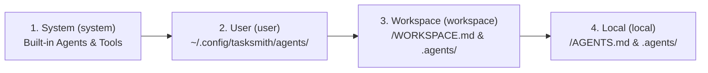
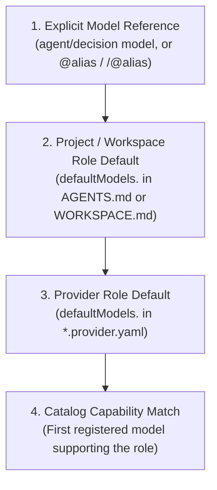
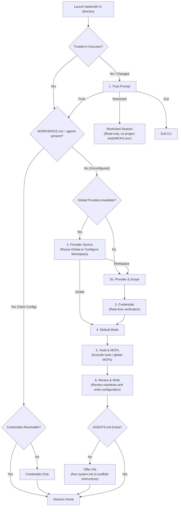

# Workspaces

A **Workspace** in TaskSmith defines the instructions, AI providers, agents, skills, commands, decisions, tools, and security policies for a project. Workspaces are configured declaratively using Markdown and YAML files committed alongside your code—or kept globally in your user configuration directory—allowing teams to version-control their AI workflows while keeping credentials and personal preferences isolated.

---

## Directory Structure

A TaskSmith workspace is anchored by a `WORKSPACE.md` file (or `AGENTS.md` for a single-project directory) and an optional `.agents/` directory containing modular resource definitions:

```text
my-workspace/
├── WORKSPACE.md                 # Workspace-wide instructions, defaults, and policies
├── .env                         # Local API keys and secrets (git-ignored)
├── .agents/
│   ├── agents/                  # Custom agent personas (*.agent.md)
│   ├── skills/                  # Reusable domain workflows (*.skill.md or <name>/SKILL.md)
│   ├── commands/                # Slash commands and prompt templates (*.command.md)
│   ├── decisions/               # Calibrated System 1 decision classifiers (*.decision.md)
│   ├── providers/               # AI provider configurations (*.provider.yaml)
│   ├── tools/                   # Custom script and HTTP tools (*.tool.md)
│   └── mcps/                    # Model Context Protocol servers (*.mcp.yaml)
└── packages/
    └── api/                     # Optional subproject in a monorepo
        ├── AGENTS.md            # Subproject-specific instructions and overrides
        └── .agents/             # Subproject-scoped agents, skills, and tools
```

> [!TIP]
> You do not need to create every directory up front. TaskSmith works out of the box in any directory using its built-in agents, tools, and your global user configuration.

---

## Four-Tier Resource Hierarchy

TaskSmith loads and merges resources across four hierarchical tiers, ordered from lowest to highest priority:



| Tier | Namespace | Location | Purpose |
| :--- | :--- | :--- | :--- |
| **1. System** | `system` | Embedded in TaskSmith; workspace built-ins mirrored in `$XDG_DATA_HOME/tasksmith/builtin/` | Built-in agents (`main`, `title-generator`), the `tasksmith-customizations` skill, and core tools. |
| **2. User** | `user` | `$XDG_CONFIG_HOME/tasksmith/agents/` | Personal providers, custom agents, and global skills available across every project on your machine. |
| **3. Workspace** | `workspace` | `<root>/WORKSPACE.md` & `<root>/.agents/` | Shared team configuration, repository conventions, and project-wide agents and tools. |
| **4. Local** | `local` | `<project>/AGENTS.md` & `<project>/.agents/` | Subproject-specific instructions and overrides when working inside a monorepo package or service. |

### Shadowing, Inheritance, and Qualified Names

- **Automatic Shadowing**: When multiple tiers define a resource with the same name (for example, a custom `main` agent in `.agents/agents/main.agent.md`), the higher-priority tier automatically overrides the lower-priority definition.
- **Cross-Tier Inheritance (`extends`)**: An agent in a higher tier can extend a lower-tier agent (such as `extends: system:main`) to inherit its base prompt, tools, and subagents while adding project-specific instructions or policies.
- **Explicit Qualification**: Any resource can be referenced unambiguously using its `<namespace>:<name>` identifier (for example, `system:main`, `user:reviewer`, or `workspace:deploy`).

---

## Workspace & Project Manifests

### `WORKSPACE.md`

Placed at the root of a repository or multi-project workspace, `WORKSPACE.md` configures default models, workspace-wide security policies, subproject paths, and shared context injected into agent prompts:

```markdown
---
apiVersion: warp/v1alpha1
kind: Workspace
metadata:
  name: acme-platform
spec:
  projects:
    - packages/api
    - packages/web
  defaultProvider: anthropic
  defaultModels:
    completion: anthropic/claude-sonnet-4-5
    decision: ollama/nimble-v3
    embedding: openai/text-embedding-3-small
  modelAliases:
    fast: anthropic/claude-haiku-4-5
    default: anthropic/claude-sonnet-4-5
  defaultAgent: main
  policies:
    tools:
      include:
        - view
        - glob
        - grep
      ask:
        - bash
        - write
        - edit
---

# Acme Platform Workspace

Follow our Go and TypeScript style guides. Always run unit tests before finalizing changes.
```

### `AGENTS.md`

Placed in a standalone project root or inside a subproject of a monorepo, `AGENTS.md` provides focused instructions and local overrides for that directory:

```markdown
---
apiVersion: warp/v1alpha1
kind: Context
metadata:
  name: api-service
  displayName: API Service
  description: Go API service conventions
---

# API Service Conventions

- All database migrations live in `internal/db/migrations/`.
- Run `go test -race ./...` to verify changes in this service.
```

For complete schema specifications of `WORKSPACE.md` and `AGENTS.md`, see the [Manifests Reference](../reference/manifests.md).

---

## Model Role Resolution

TaskSmith routes AI workloads across three specialized cognitive roles:

1. **Completion (`completion`)**: Multi-turn reasoning, code generation, and tool execution.
2. **Decision (`decision`)**: Fast, calibrated probabilistic classification and routing.
3. **Embedding (`embedding`)**: Vector generation for semantic search and workspace indexing.

When resolving which model to use for a given role, TaskSmith evaluates candidates in order of specificity. Model identifiers may be fully qualified (`<provider>/<model-id>`) or shorthand aliases declared in `WORKSPACE.md` `modelAliases` (referenced as `@<alias>`, `@default`, or `<provider>/@<alias>`):



---

## Environment Variables & Secrets (`.env`)

TaskSmith isolates credentials per workspace and never mutates the host shell environment. When opening or reloading a workspace, secrets are resolved using a layered hierarchy where process environment variables serve as the foundation fallback layer and on-disk `.env` files override them in increasing order of specificity:

| Priority | Source / File Path | Typical Use Case |
| :--- | :--- | :--- |
| **1 (Base Fallback)** | Process Environment (`os.Getenv`) | Host shell environment variables passed directly when starting the daemon or CLI. |
| **2** | `$XDG_CONFIG_HOME/tasksmith/.env` | Personal API keys shared across all workspaces (`ANTHROPIC_API_KEY`, `OPENAI_API_KEY`). |
| **3** | `<worktree-hub>/.env` | Shared secrets located in the parent directory of a bare-repository worktree hub. |
| **4** | `<workspace-root>/.env` | Repository-specific API keys and endpoints committed or kept at workspace root. |
| **5 (Highest)** | `<subproject>/.env` | Service-local overrides when working inside a monorepo subproject or package. |

Higher-priority `.env` files override variables set in lower tiers. If an environment variable is omitted across all `.env` files, TaskSmith falls back to `os.Getenv`.

TaskSmith maintains two distinct environment views from these layers:
- **Daemon Credential View (`Env()`)**: Includes all 5 tiers above and powers `ModelProvider` `auth.env` resolution and MCP `${VAR}` credential expansion inside the daemon.
- **Subprocess Environment (`SubprocessEnv()`)**: Passed to `bash` commands and custom tool subprocesses (and updated live on workspace reload). It preserves the user's host shell environment (`GH_TOKEN`, `NPM_TOKEN`, `AWS_*`, `PATH`, etc.) and, in trusted workspaces, project `.env` layers (tiers 3–5), while excluding `$XDG_CONFIG_HOME/tasksmith/.env` (`~/.config/tasksmith/.env`), variables declared in configured `ModelProvider` `spec.auth.env` manifests, and the `TASKSMITH_*` internal namespace. In **Restricted Mode**, project `.env` layers (tiers 3–5) are omitted from both views.

For detailed information on authentication schemes, provider manifests, and lazy credential validation, see the [Providers Reference](../reference/providers.md).

> [!IMPORTANT]
> When TaskSmith saves an API key during setup or provider configuration, it writes the key to `.env` with `0600` permissions and automatically ensures `.env` is listed in `.gitignore`.

---

## First-Run Onboarding & Trust Model

When TaskSmith is launched in a directory for the first time, it performs a deterministic security check before creating any session or accessing repository configuration:



### 1. Trust Model (`trust.json`)

To protect your system from executing untrusted scripts, MCP servers, or environment files from arbitrary repositories, TaskSmith requires an explicit trust decision before executing project code:

- **Location**: Stored machine-wide at `~/.local/share/tasksmith/trust.json` (`$XDG_DATA_HOME/tasksmith/trust.json`).
- **Trust Scopes**:
  - **Folder Scope**: Grants trust only to the specific directory path.
  - **Parent Scope**: Grants trust to the directory and all of its subdirectories (ideal for workspaces grouped under a shared directory like `~/Projects/`).
- **Fingerprint Change Detection**: TaskSmith records a cryptographic hash of executable definitions (`.agents/tools/`, `.agents/mcps/`, `.env`). If an untrusted git pull or checkout introduces new or modified executable configurations, TaskSmith detects the fingerprint divergence and re-prompts for trust.
- **Restricted Mode**: If trust is declined, TaskSmith opens a safe restricted session:
  - Project-level tools (`.agents/tools/`) and project MCP servers (`.agents/mcps/`) are disabled.
  - Local repository `.env` files are ignored (only global `$XDG_CONFIG_HOME/tasksmith/.env` applies).
  - Mutating operations require explicit user approval.

### 2. Interactive Setup Wizard (`/setup`)

The setup wizard can be re-run at any time using the `/setup` slash command. It provides a cohesive configuration hub:

1. **Provider Source**: Choose whether to inherit shared model providers from `~/.config/tasksmith/` or configure project-specific settings.
2. **Provider & Scope**: Select provider preset (e.g., Anthropic, OpenAI, Ollama, Gemini) and target persistence scope:
   - **User Scope**: Persists credentials in `~/.config/tasksmith/.env` and provider definition in `~/.config/tasksmith/agents/providers/<name>.yaml`, leaving the repository untouched.
   - **Workspace Scope**: Commits `WORKSPACE.md` policies and repository configuration while keeping secrets in git-ignored `<workspace-root>/.env`.
   - **Project Scope**: Writes project overrides in `<subproject>/AGENTS.md`.
3. **Real-Time Credential Verification**: Tests upstream API keys, connects via interactive browser OAuth (e.g., Antigravity/Google Cloud Code), and validates custom endpoints live before writing configuration files to disk.
4. **Permission Mode & Tool Toggles**: Set default session permission mode and selectively exclude built-in tools or global MCP servers.
5. **Review & Write**: Summarizes planned filesystem mutations and offers to run `/init` if `AGENTS.md` is not yet present.

---

## Workspace Metadata & Version Migrations (`workspace.json`)

TaskSmith tracks workspace state and engine versioning using an isolated metadata file:

- **Path**: `~/.local/share/tasksmith/workspaces/<hash>/workspace.json`
- **Schema**:
  ```json
  {
    "schema": 1,
    "version": "0.1.0"
  }
  ```

### Automated Migration Pipeline

When opening a workspace, the Brain daemon checks the stored `version` against the running binary version:

1. **Ascending Semver Execution**: If the running version is newer than the recorded `version`, TaskSmith executes all registered migration actions in strict ascending semver order.
2. **Atomic Version Updates**: After all migrations succeed, `workspace.json` is updated to the running version. If a migration fails, execution halts immediately and the version remains at the last successfully applied step, allowing clean retries on subsequent runs.
3. **Downgrade Safety**: If a workspace was previously opened with a newer TaskSmith binary, the daemon skips migrations, leaves the file untouched, and logs a downgrade notice.
4. **Development Builds**: Non-semver development versions skip automated migrations to avoid corrupting workspace metadata.
5. **Committed Files Guard**: Migrations that alter version-controlled files (`WORKSPACE.md` or `.agents/`) are never applied silently in the background; they surface as "Upgrade available" in `/setup` and require explicit user review.

---

## Repository Topologies & Startup Flows

TaskSmith works seamlessly across plain directories, standard Git repositories, linked Git worktrees, and bare-repository worktree hubs (`.bare`):

### 1. Plain Directory or Standard Repository
When opened, TaskSmith verifies directory trust and checks for workspace configuration. If uninitialized, it presents the first-run onboarding wizard. Once configured, subsequent launches immediately open the interactive session.

### 2. Bare Repositories & Worktree Hubs (`.bare`)
For developers who organize repositories with sibling branch worktrees:
- **Branch Selection**: Opening the hub directory prompts to select or create a branch worktree.
- **Configuration Sharing**: When a branch worktree contains configuration, TaskSmith prompts whether to share it across all sibling worktrees at the hub root or keep it scoped to that specific branch.
