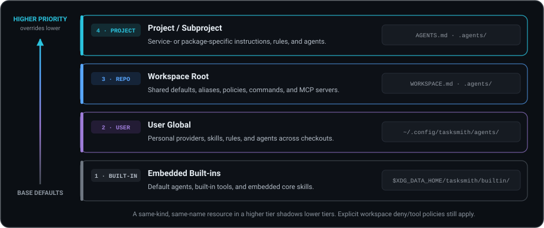

# Configure a workspace for your team

Share instructions and defaults across a repository while keeping service-specific conventions close to the code.
Choose where a setting belongs, layer credentials without exposing them to tools, and reload a running session.

## Directory structure

Start small. Add `WORKSPACE.md` when you need a shared root; use `AGENTS.md` for instructions
that belong to a particular project. Create resource directories only as you need them.

```text
my-workspace/
├── WORKSPACE.md
├── .env
├── .agents/
│   ├── agents/
│   ├── skills/
│   ├── rules/
│   ├── commands/
│   ├── decisions/
│   ├── providers/
│   ├── tools/
│   └── mcps/
└── packages/
    └── api/
        ├── AGENTS.md
        └── .agents/
```

Keep shared personas, skill runbooks, conditional rules, slash commands, provider definitions,
script or HTTP tools, and MCP server manifests in `.agents/`. Decision definitions describe
classifiers; declaring one isn't a guarantee that a runtime evaluates it.
For filename conventions and kinds, use the [manifest directory](../reference/manifests.md).

## How the four-tier hierarchy works

A higher tier can replace a same-kind, same-name resource from a lower one. Put a personal preference in user scope and a team convention in the repository.



| Tier | Example |
| --- | --- |
| Built-in | The `main` and `title-generator` agents and built-in skills. Workspace built-ins are mirrored under `$XDG_DATA_HOME/tasksmith/builtin/`. |
| User | A provider or skill you reuse across checkouts, under `$XDG_CONFIG_HOME/tasksmith/agents/`. |
| Workspace | A shared review command in `<workspace-root>/.agents/commands/`. |
| Project | An API-specific agent in `packages/api/.agents/agents/`. |

For example, a project `main` agent shadows the built-in `main` for a short-name lookup.
Use `system/Agent/main` when you mean the built-in regardless of shadowing; agent `extends`
lets you inherit a base prompt, tools, and subagents rather than copying the definition.
`local` selects the current project with workspace fallback. Plugins can also export namespaced resources.

## Configure `WORKSPACE.md` and `AGENTS.md`

Put settings that should follow the repository in the frontmatter of `WORKSPACE.md`.
Put shared instructions in the Markdown body. For a repository with two packages:

```markdown
---
apiVersion: warp/v1alpha1
kind: Workspace
metadata:
  name: acme-platform
spec:
  projects:
    - packages/api
    - packages/web
  defaultProvider: anthropic
  defaultModels:
    completion: anthropic/claude-sonnet-4-5
  modelAliases:
    default: anthropic/claude-sonnet-4-5
  defaultAgent: main
  policies:
    tools:
      ask:
        - bash
        - write
        - edit
---

# Acme Platform

Run the affected package's tests before declaring a change complete.
```

Use a provider and model actually configured in your workspace. `completion` serves chat
and tool use; `decision` names a classification model and `embedding` a vector model.
Resolution starts with an explicit model or alias, then project/workspace role defaults,
provider role defaults, and finally a compatible catalog model. Use `provider/model-id`,
`@alias`, or `provider/@alias` to select a model.

`/providers` lets you disable a provider without deleting its endpoint, credentials reference,
or model definitions. Its models and aliases then disappear from resolution. A workspace shadow
can disable an inherited user provider locally. The model manager and `F2` alias editor persist
model/default/alias settings; workspace `spec.modelAliases` takes precedence.

## Work in monorepos and subprojects

List package paths relative to the workspace root under `spec.projects`, as above.
In `packages/api/AGENTS.md`, describe only what differs in that package:

```markdown
---
apiVersion: warp/v1alpha1
kind: Context
metadata:
  name: api-service
  displayName: API Service
  description: Go API service conventions
---

# API service

Migrations live in `internal/db/migrations/`.
Run `go test -race ./...` from this package after changing a handler.
```

Open the API project from the workspace root:

```bash
tasksmith -w packages/api
```

TaskSmith looks upward for `WORKSPACE.md` and selects the project context. Without a manifest
it creates a synthetic workspace. In a flat workspace whose only project is `.`, the root
`.agents/` is loaded as project resources, not duplicated at two tiers.

In a plain directory or ordinary Git checkout, first launch goes through trust and setup if needed.
For a bare-repository hub (`.bare`) with sibling worktrees, opening the hub offers a branch
worktree to select or create. If a branch contains configuration, choose whether to share it
at the hub root or keep it branch-specific. A linked worktree can still have its own `.env`.

## Layer secrets with `.env` files

Reference secrets by variable name in provider and MCP `spec.auth` manifests (for example,
`${env:ANTHROPIC_API_KEY}` or `${file:...}`), not by value. MCP `spec.env`, `spec.headers`,
and `spec.command` fields expand `${VAR}` placeholders. TaskSmith resolves these for the workspace
without mutating your shell. On open or reload, **later rows override earlier rows** for the same name:

| Order | Source | Use it for |
| --- | --- | --- |
| 1 | Daemon process environment | Fallback if no file supplies a value. |
| 2 | `$XDG_CONFIG_HOME/tasksmith/.env` | Personal provider keys across projects. |
| 3 | `<worktree-hub>/.env` | Shared credentials for sibling worktrees. |
| 4 | `<workspace-root>/.env` | Checkout-specific keys or endpoints. |
| 5 | `<subproject>/.env` | Service-local overrides. |

For example, keep a shared endpoint at the root and override only its address in the API
project's `.env`. Do not commit either file if it contains credentials. When setup saves a key
it uses mode `0600` and ensures the repository `.env` is ignored by Git.

**What reaches commands?** The daemon credential view includes all applicable layers. The
subprocess view for Bash and custom tools preserves host variables such as `PATH`, `GH_TOKEN`,
`NPM_TOKEN`, and `AWS_*` and trusted project layers, but excludes the personal `.env` layer,
variables referenced by provider `spec.auth` environment expressions, and internal `TASKSMITH_*`
variables. Reload refreshes this view for subsequent subprocesses.

In Restricted Mode, hub, workspace, and subproject `.env` files are omitted from **both** views.
Don't diagnose a missing provider key by printing the environment into a terminal transcript;
check scope, trust, and the provider's credential status instead.

## Track workspace metadata (`workspace.json`)

Workspace state belongs to the daemon, not to the repository. Its version marker lives at
`$XDG_DATA_HOME/tasksmith/workspaces/<hash>/workspace.json` (normally under `~/.local/share/`).
A marker looks like this:

```json
{
  "schema": 1,
  "version": "0.1.0"
}
```

On open, a newer release applies registered migrations in ascending version order. A failed
step stops the upgrade; the marker stays at the last successful step for retry. An older
binary leaves a newer marker alone and logs the downgrade. Non-semver development builds skip migrations.
If an upgrade would change tracked configuration, inspect **Upgrade available** in `/setup`;
those repository edits require review rather than a silent background rewrite.

## Reload a workspace (`/workspace`)

After changing files on disk, return to the composer and run:

```text
/workspace reload
```

With no turns yet, reload is immediate. With history, **Cancel** is selected by default:
changing the system prompt or available tools can invalidate the provider's prompt cache,
so previously cached input may be billed at the uncached rate on the next turn. Select
**Reload workspace** and press `Enter` to continue, or `Esc` to leave it unchanged.

If you have already considered that cost, skip the confirmation deliberately:

```text
/workspace reload --force
```

`/ws -y` is the short form; `refresh` is also accepted for `reload`. Check `/warnings`
afterward for active workspace, provider, alias, or MCP configuration problems.

## Next steps

- [Decide which workspace configurations to trust](./trust.md).
- [Create a shared command or skill](./customizations.md).
- [Look up workspace and project manifest fields](../reference/manifests/workspace.md).
- [Check provider authentication and model resolution](../reference/providers.md).
