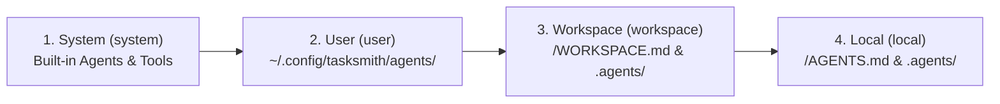
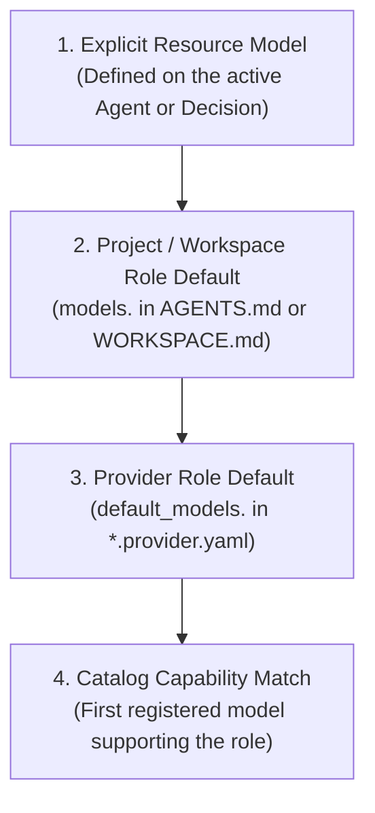
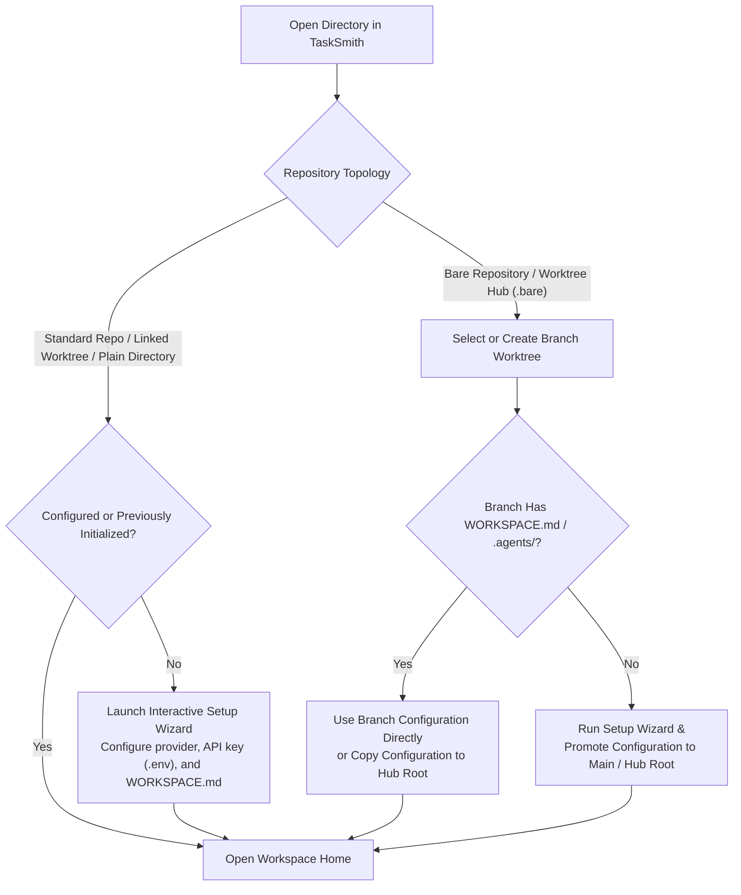

# Workspaces

A **Workspace** in TaskSmith defines the instructions, AI providers, agents, skills, commands, decisions, tools, and security policies for a project. Workspaces are configured declaratively using Markdown and YAML files committed alongside your code—or kept globally in your user configuration directory—allowing teams to version-control their AI workflows while keeping credentials and personal preferences isolated.

---

## Directory Structure

A TaskSmith workspace is anchored by a `WORKSPACE.md` file (or `AGENTS.md` for a single-project directory) and an optional `.agents/` directory containing modular resource definitions:

```text
my-workspace/
├── WORKSPACE.md                 # Workspace-wide instructions, defaults, and policies
├── .env                         # Local API keys and secrets (git-ignored)
├── .agents/
│   ├── agents/                  # Custom agent personas (*.agent.md)
│   ├── skills/                  # Reusable domain workflows (*.skill.md or <name>/SKILL.md)
│   ├── commands/                # Slash commands and prompt templates (*.command.md)
│   ├── decisions/               # Calibrated System 1 decision classifiers (*.decision.md)
│   ├── providers/               # AI provider configurations (*.provider.yaml)
│   ├── tools/                   # Custom script and HTTP tools (*.tool.md)
│   ├── toolkits/                # Curated tool bundles (*.toolkit.yaml)
│   └── mcps/                    # Model Context Protocol servers (*.mcp.yaml)
└── packages/
    └── api/                     # Optional subproject in a monorepo
        ├── AGENTS.md            # Subproject-specific instructions and overrides
        └── .agents/             # Subproject-scoped agents, skills, and tools
```

> [!TIP]
> You do not need to create every directory up front. TaskSmith works out of the box in any directory using its built-in agents, tools, and your global user configuration.

---

## Four-Tier Resource Hierarchy

TaskSmith loads and merges resources across four hierarchical tiers, ordered from lowest to highest priority:



| Tier | Namespace | Location | Purpose |
| :--- | :--- | :--- | :--- |
| **1. System** | `system` | Embedded in TaskSmith; workspace built-ins mirrored in `$XDG_DATA_HOME/tasksmith/builtin/` | Built-in agents (`main`, `title-generator`), the `tasksmith-customizations` skill, and core tools. |
| **2. User** | `user` | `$XDG_CONFIG_HOME/tasksmith/agents/` | Personal providers, custom agents, and global skills available across every project on your machine. |
| **3. Workspace** | `workspace` | `<root>/WORKSPACE.md` & `<root>/.agents/` | Shared team configuration, repository conventions, and project-wide agents and tools. |
| **4. Local** | `local` | `<project>/AGENTS.md` & `<project>/.agents/` | Subproject-specific instructions and overrides when working inside a monorepo package or service. |

### Shadowing, Inheritance, and Qualified Names

- **Automatic Shadowing**: When multiple tiers define a resource with the same name (for example, a custom `main` agent in `.agents/agents/main.agent.md`), the higher-priority tier automatically overrides the lower-priority definition.
- **Cross-Tier Inheritance (`extends`)**: An agent in a higher tier can extend a lower-tier agent (such as `extends: system:main`) to inherit its base prompt, tools, and subagents while adding project-specific instructions or policies.
- **Explicit Qualification**: Any resource can be referenced unambiguously using its `<namespace>:<name>` identifier (for example, `system:main`, `user:reviewer`, or `workspace:deploy`).

---

## Workspace & Project Manifests

### `WORKSPACE.md`

Placed at the root of a repository or multi-project workspace, `WORKSPACE.md` configures default models, workspace-wide security policies, subproject paths, and shared context injected into agent prompts:

```markdown
---
name: acme-platform
default_agent: main
models:
  completion:
    - anthropic/claude-sonnet-4-5
  decision:
    - ollama/nimble-v3
    - anthropic/claude-haiku-4-5
  embedding:
    - openai/text-embedding-3-small
projects:
  - packages/api
  - packages/web
policies:
  allow_tools:
    - view
    - glob
    - grep
  ask_tools:
    - bash
    - write
    - edit
---

# Acme Platform Workspace

Follow our Go and TypeScript style guides. Always run unit tests before finalizing changes.
```

### `AGENTS.md`

Placed in a standalone project root or inside a subproject of a monorepo, `AGENTS.md` provides focused instructions and local overrides for that directory:

```markdown
---
name: api-service
default_agent: backend-engineer
---

# API Service Conventions

- All database migrations live in `internal/db/migrations/`.
- Run `go test -race ./...` to verify changes in this service.
```

For complete schema specifications of `WORKSPACE.md` and `AGENTS.md`, see the [Manifests Reference](../reference/manifests.md).

---

## Model Role Resolution

TaskSmith routes AI workloads across three specialized cognitive roles:

1. **Completion (`completion`)**: Multi-turn reasoning, code generation, and tool execution.
2. **Decision (`decision`)**: Fast, calibrated probabilistic classification and routing.
3. **Embedding (`embedding`)**: Vector generation for semantic search and workspace indexing.

When resolving which model to use for a given role, TaskSmith evaluates candidates in order of specificity:



---

## Environment Variables & Secrets (`.env`)

TaskSmith isolates credentials per workspace and never mutates the host shell environment. When opening or reloading a workspace, secrets are resolved using a layered hierarchy where process environment variables serve as the foundation fallback layer and on-disk `.env` files override them in increasing order of specificity:

| Priority | Source / File Path | Typical Use Case |
| :--- | :--- | :--- |
| **1 (Base Fallback)** | Process Environment (`os.Getenv`) | Host shell environment variables passed directly when starting the daemon or CLI. |
| **2** | `$XDG_CONFIG_HOME/tasksmith/.env` | Personal API keys shared across all workspaces (`ANTHROPIC_API_KEY`, `OPENAI_API_KEY`). |
| **3** | `<worktree-hub>/.env` | Shared secrets located in the parent directory of a bare-repository worktree hub. |
| **4** | `<workspace-root>/.env` | Repository-specific API keys and endpoints committed or kept at workspace root. |
| **5 (Highest)** | `<subproject>/.env` | Service-local overrides when working inside a monorepo subproject or package. |

Higher-priority `.env` files override variables set in lower tiers. If an environment variable is omitted across all `.env` files, TaskSmith falls back to `os.Getenv`.

For detailed information on authentication schemes, provider manifests, and lazy credential validation, see the [Providers Reference](../reference/providers.md).

> [!IMPORTANT]
> When TaskSmith saves an API key during setup or provider configuration, it writes the key to `.env` with `0600` permissions and automatically ensures `.env` is listed in `.gitignore`.

---

## Repository Topologies & Startup Flows

TaskSmith works seamlessly across plain directories, standard Git repositories, linked Git worktrees, and bare-repository worktree hubs (`.bare`):



### 1. Uninitialized Repository or Directory
When launched in a standard Git repository or plain directory that has no `WORKSPACE.md`, `.agents/`, or prior trust record, TaskSmith opens the interactive **Setup Wizard** to select a provider preset, configure credentials, and scaffold initial workspace files (or mark the directory as trusted using global settings).

### 2. Initialized Repository or Linked Worktree
When launched in a directory that already contains `WORKSPACE.md` / `.agents/` or has completed initial setup, TaskSmith loads the four-tier resource hierarchy and opens the **Home** view immediately.

### 3. Bare Repositories & Worktree Hubs (`.bare`)
For developers who organize projects around a bare Git repository with sibling branch worktrees:
- **Branch Selection**: Opening the bare repository root prompts you to check out an existing branch worktree or create a new one.
- **Configuration Sharing**:
  - If the selected branch worktree already contains `WORKSPACE.md` or `.agents/`, TaskSmith asks whether to copy the configuration to the hub root (so all sibling worktrees share it) or use it directly from the branch worktree.
  - If neither the hub root nor the branch worktree is configured yet, TaskSmith runs the Setup Wizard and promotes the generated configuration to the hub root / `main` branch.
