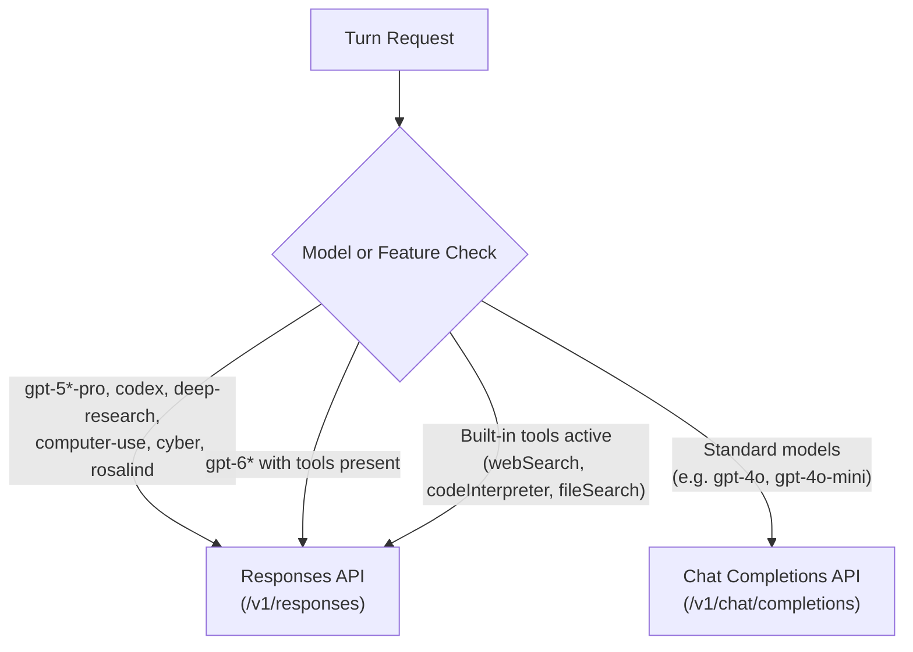

# OpenAI Provider

The **OpenAI** provider connects TaskSmith to OpenAI's frontier reasoning and conversational models, as well as any third-party inference platform implementing the OpenAI API specification.

---

## 1. Overview & Capabilities

TaskSmith's OpenAI provider integrates with both the traditional **Chat Completions API** (`/v1/chat/completions`) and the stateful **Responses API** (`/v1/responses`). It covers all three cognitive workload roles:

- **Completion (`completion` — System 2)**: Multi-turn conversational reasoning, code generation, and function/tool execution using models such as `gpt-5.5`, `gpt-5.5-pro`, `gpt-5-codex`, and `o3`.
- **Decision (`decision` — System 1)**: Calibrated probabilistic classification and routing, either via native decision models or via the gateway's automatic structured-output completion fallback adapter.
- **Embedding (`embedding` — System 3)**: High-throughput dense vector embedding generation using `text-embedding-3-small` and `text-embedding-3-large`.

In addition to official OpenAI endpoints, this provider can connect to OpenAI-compatible inference servers, including **Azure OpenAI**, **vLLM**, **LiteLLM**, **OpenRouter**, **Together AI**, **Groq**, and self-hosted model gateways.

---

## 2. Quick Start

### Step 1: Set Your API Key

Add your OpenAI API key to your environment. TaskSmith loads secrets automatically using its hierarchical `.env` resolution:

```bash
# In your project root .env (recommended for project-specific isolation)
OPENAI_API_KEY=sk-proj-...
```

Alternatively, store it in your global user configuration to share it across all workspaces on your machine:

```bash
# ~/.config/tasksmith/.env
OPENAI_API_KEY=sk-proj-...
```

TaskSmith also reads host process environment variables (`export OPENAI_API_KEY=...`) as a base fallback layer.

### Step 2: Configure the Provider Manifest

Create `.agents/providers/openai.yaml` in your workspace (or `~/.config/tasksmith/providers/openai.yaml` for global availability):

```yaml
apiVersion: warp/v1alpha1
kind: ModelProvider
metadata:
  name: openai
spec:
  type: openai
  endpoint: https://api.openai.com/v1
  defaultModel: gpt-5.5
  config:
    # TaskSmith defaults to Zero Data Retention (store: false) on the Responses API
    store: false
  auth:
    type: env
    env: OPENAI_API_KEY
  models:
    - id: gpt-5.5
      name: gpt-5.5
      label: GPT-5.5
      limits:
        context: 1050000
        output: 128000
      capabilities:
        completion: true
        tools: true
        structuredOutput: true
        thinking:
          - type: effort
            default: medium
            isDefault: true
            allowedEfforts: [low, medium, high]
    - id: gpt-5.5-pro
      name: gpt-5.5-pro
      label: GPT-5.5 Pro
      limits:
        context: 1050000
        output: 128000
      capabilities:
        completion: true
        tools: true
    - id: gpt-5-codex
      name: gpt-5-codex
      label: GPT-5 Codex
      limits:
        context: 1050000
        output: 128000
      capabilities:
        completion: true
        tools: true
    - id: o3
      name: o3
      label: o3
      limits:
        context: 200000
        output: 100000
      capabilities:
        completion: true
        tools: true
        thinking:
          - type: effort
            default: high
            isDefault: true
            allowedEfforts: [low, medium, high]
    - id: text-embedding-3-small
      name: text-embedding-3-small
      label: Text Embedding 3 Small
      limits:
        context: 8191
        dimensions: 1536
      capabilities:
        completion: false
        embedding: true
```

---

## 3. Chat Completions vs. Responses API (`spec.config.apiMode`)

TaskSmith leverages [Loom](https://github.com/masterkeysrd/loom) to interface with OpenAI. Loom supports both OpenAI wire protocols:

1. **Chat Completions API** (`POST /v1/chat/completions`): The standard stateless API used across most chat models and third-party compatible providers.
2. **Responses API** (`POST /v1/responses`): OpenAI's modern API supporting stateful session chains, native server-side tools (web search, code interpreter, file search), and encrypted reasoning preservation.

### Automatic Mode (Default)

When `spec.config.apiMode` is omitted, Loom operates in **Automatic Mode**. It inspects the target model and request parameters on every turn to route requests to the optimal endpoint:



- **Responses API Routing**: Models requiring deep reasoning or Responses-only features (`gpt-5-pro`, `gpt-5.2-pro`, `gpt-5.4-pro`, `gpt-5.5-pro`, `gpt-5.6-sol`, `*codex*`, `*deep-research*`, `computer-use*`, `*cyber*`, `*rosalind*`, and `gpt-6*` when tools are present) are routed to `/v1/responses`.
- **Chat Completions Routing**: Standard conversational models without Responses-exclusive features default to `/v1/chat/completions`.

### Explicit Mode

You can force a specific API across all models for a provider using `spec.config.apiMode`:

#### Forcing Responses API:
```yaml
spec:
  config:
    apiMode: responses
```
*(Alternatively, set `responsesAPI: true`)*

#### Forcing Chat Completions API:
```yaml
spec:
  config:
    apiMode: chat_completions
```
*(Alternatively, set `responsesAPI: false`)*

> [!TIP]
> When pointing `spec.endpoint` to third-party OpenAI-compatible providers (such as OpenRouter, LiteLLM, vLLM, or Together AI), always set `apiMode: chat_completions`. These engines typically implement `/v1/chat/completions` but do not support `/v1/responses`.

---

## 4. Data Retention & Privacy (`spec.config.store`)

### Zero Data Retention (ZDR) by Default (`store: false`)

TaskSmith is engineered for strict privacy and data isolation. When communicating over OpenAI's Responses API, **TaskSmith defaults to `store: false`**:

```yaml
spec:
  config:
    store: false
```

When `store: false` is active:
- OpenAI **does not persist conversation state or messages** on its servers between turns.
- TaskSmith maintains the authoritative conversation history locally within the daemon's local session journal and timeline.
- **Encrypted Reasoning Continuation**: OpenAI models generating reasoning items (such as `o3` and `gpt-5.5`) emit encrypted reasoning tokens. TaskSmith and Loom extract these payloads (`openai.encrypted_content` and `openai.reasoning_id`) from streaming chunks and store them in local message history. On subsequent turns, Loom automatically passes them back to OpenAI inside `ResponseInputItemUnionParam::OfReasoning`, ensuring seamless multi-turn reasoning continuity without sacrificing Zero Data Retention.

### Opting In to Server-Side State (`store: true`)

If you prefer OpenAI to manage conversation history server-side and reduce wire transfer sizes, set `store: true`:

```yaml
spec:
  config:
    store: true
    usePreviousResponseID: true
```

When `usePreviousResponseID: true` is enabled:
1. On turn 1, TaskSmith sends the full initial conversation payload to OpenAI.
2. OpenAI returns a response accompanied by a unique response identifier (`resp_...`).
3. On turn 2 and beyond, Loom detects the previous response ID in metadata, populates `previous_response_id: "resp_..."` on the request, and **prunes preceding messages from the wire payload**. Only new user messages or tool call outputs are sent over the wire.

---

## 5. Built-in Responses API Tools

OpenAI's Responses API supports native, server-side tools executed directly on OpenAI's infrastructure. You can enable them declaratively in `spec.config`:

```yaml
spec:
  config:
    # Native Web Search
    webSearch: true

    # Native Code Interpreter (Python sandbox)
    codeInterpreter: true

    # Native Vector Store File Search
    fileSearch:
      vectorStoreIDs:
        - vs_abc123xyz
        - vs_docs456def
      maxNumResults: 10
```

### Supported Native Tools

1. **Web Search (`webSearch: true`)**:
   Allows the model to search the web using OpenAI's built-in real-time search engine.
2. **Code Interpreter (`codeInterpreter: true`)**:
   Allows the model to generate and execute Python code in OpenAI's sandboxed environment, analyze datasets, and process data files.
3. **File Search (`fileSearch`)**:
   Queries one or more pre-indexed OpenAI Vector Stores (`vs_...`) using semantic search and automatically injects relevant citation snippets into the context.

> [!NOTE]
> Native Responses API tools run on OpenAI's servers and require internet access on OpenAI's side. They operate in parallel with TaskSmith's local sandbox tools (`view`, `edit`, `write`, `bash`, `grep`, `glob`).

---

## 6. Configuration Reference (`spec.config`)

The following options can be set under `spec.config` in `.agents/providers/openai.yaml`:

| Key | Type | Default | Description |
| :--- | :--- | :--- | :--- |
| `apiMode` | `string` | *(auto)* | Endpoint protocol mode: `"responses"` or `"chat_completions"`. When omitted, auto-routes per model. |
| `responsesAPI` | `boolean` | *(auto)* | Legacy alias for `apiMode`. `true` forces Responses API; `false` forces Chat Completions. |
| `store` | `boolean` | `false` | When using Responses API, determines if OpenAI stores turn history server-side. TaskSmith defaults to `false` (ZDR). |
| `usePreviousResponseID` | `boolean` | `false` | When `store: true`, automatically chains turns via `previous_response_id` and trims redundant wire messages. |
| `webSearch` | `boolean` | `false` | Enables OpenAI's native server-side web search tool. |
| `codeInterpreter` | `boolean` | `false` | Enables OpenAI's native sandboxed Python execution tool. |
| `fileSearch.vectorStoreIDs` | `[]string` | `[]` | List of OpenAI vector store IDs (`vs_...`) to search during generation. |
| `fileSearch.maxNumResults` | `integer` | `10` | Maximum number of vector search chunks to retrieve per search query (1–50). |

---

## 7. Model Catalog & Thinking Effort

Models are declared under `spec.models`. For models supporting variable reasoning intensity (such as `gpt-5.5`, `gpt-5.5-pro`, and `o3`), declare reasoning capabilities using `thinking` with `type: effort` (`allowedEfforts: [low, medium, high]`).

In the TaskSmith CLI, `/effort` offers the levels supported by the active model. For complete documentation on capability flags, token limits, and cost schemas, see the [Providers Overview](../providers.md).

---

## 8. Using OpenAI-Compatible Endpoints

To use an alternative inference provider that supports the OpenAI API schema (e.g. OpenRouter, vLLM, LiteLLM, Ollama OpenAI endpoint, Together AI), configure `spec.endpoint`, point credentials to the appropriate environment variable, and set `apiMode: chat_completions`.

### Example: OpenRouter

```yaml
apiVersion: warp/v1alpha1
kind: ModelProvider
metadata:
  name: openrouter
spec:
  type: openai
  endpoint: https://openrouter.ai/api/v1
  defaultModel: anthropic/claude-3.7-sonnet
  config:
    apiMode: chat_completions
  headers:
    HTTP-Referer: https://tasksmith.dev
    X-Title: TaskSmith
  auth:
    type: bearer
    env: OPENROUTER_API_KEY
  models:
    - id: anthropic/claude-3.7-sonnet
      name: anthropic/claude-3.7-sonnet
      label: Claude 3.7 Sonnet (OpenRouter)
      limits:
        context: 200000
        output: 64000
      capabilities:
        completion: true
        tools: true
    - id: meta-llama/llama-3.3-70b-instruct
      name: meta-llama/llama-3.3-70b-instruct
      label: Llama 3.3 70B (OpenRouter)
      limits:
        context: 128000
        output: 8192
      capabilities:
        completion: true
        tools: true
```

### Example: Self-Hosted vLLM / LiteLLM

```yaml
apiVersion: warp/v1alpha1
kind: ModelProvider
metadata:
  name: local-vllm
spec:
  type: openai
  endpoint: http://10.0.0.50:8000/v1
  defaultModel: qwen-2.5-coder-32b
  config:
    apiMode: chat_completions
  auth:
    type: bearer
    env: VLLM_API_KEY # Or omit auth if the cluster is internal/unauthenticated
  models:
    - id: qwen-2.5-coder-32b
      name: qwen-2.5-coder-32b
      label: Qwen 2.5 Coder 32B (Local vLLM)
      limits:
        context: 32768
        output: 8192
      capabilities:
        completion: true
        tools: true
```

---

## Related Documentation

- [Providers Overview & Manifest Reference](../providers.md)
- [Gateway Architecture](../../architecture/gateway.md)
- [Workspaces Guide](../../guides/workspaces.md)
